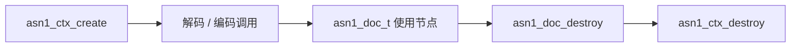

# C API 设计规范

本文件定义对外 C ABI 的设计基线。签名在实现阶段落地为公共头文件；实现若需偏离，必须先修订本文件并补 ADR。

## 1. 设计原则

1. **唯一公共边界是 C ABI**。公共头文件使用 C99 语法，C 与 C++ 调用方完全等价。
2. **不透明句柄**。公共头文件只声明 `struct asn1_ctx;`、`struct asn1_doc;`、`struct asn1_node;` 等不完整类型，定义只存在于 `src/` 内部。
3. **不泄漏 C++**。公共头文件不得包含 `<string>`、`<vector>`、`<memory>` 等 C++ 头，不得出现模板、引用、类、`bool`（使用 `int`）、异常规格。
4. **错误码优先**。所有可能失败的操作返回 `asn1_err_t`；不使用 `errno` 作为主错误通道，不抛出异常。
5. **显式所有权**。谁创建、谁释放、借用引用何时失效，必须在函数注释中写明。
6. **可演进的结构体**。所有跨 ABI 的配置/信息结构体首字段为 `size_t struct_size`，调用方必须初始化为 `sizeof(...)`；预留字段必须置零。
7. **核心零领域知识**。核心公共头文件与符号不得出现 X.509、PKIX、CMS、PKCS、证书、密钥、签名算法等领域概念；标准结构由独立模块包提供。
8. **模块独立**。模块拥有自己的头文件、包名、符号前缀和版本，只依赖核心 ABI；核心头文件不包含模块头文件。

## 2. 命名约定

| 类别 | 规则 | 示例 |
| --- | --- | --- |
| 核心函数 | `asn1_` + 动作，全小写下划线 | `asn1_decode_buffer`、`asn1_schema_load` |
| 模块函数 | `asn1_<模块>_` + 动作 | `asn1_pkix_cert_get_subject`、`asn1_cms_content_type` |
| 核心不透明类型 | `asn1_` + 名词 + `_t` | `asn1_ctx_t`、`asn1_doc_t`、`asn1_schema_t` |
| 模块类型 | `asn1_<模块>_` + 名词 + `_t` | `asn1_pkix_cert_t` |
| 核心枚举值 | `ASN1_` + 枚举组 + 值 | `ASN1_ENCODING_DER`、`ASN1_TAG_CONTEXT` |
| 模块枚举值 | `ASN1_<模块>_` + 枚举组 + 值 | `ASN1_PKIX_FIELD_SUBJECT` |
| 核心错误码 | `ASN1_E_` + 分类 + 名称 | `ASN1_E_TRUNCATED`、`ASN1_E_NOMEM` |
| 模块错误码 | `ASN1_<模块>_E_` + 名称 | `ASN1_PKIX_E_FIELD_MISSING` |
| 导出宏 | 核心 `ASN1_API`；模块 `ASN1_<模块>_API` | `ASN1_PKIX_API` |
| 预留接口 | 统一使用 `_reserved` 字段，不占用公共符号 | — |

禁止使用双下划线或下划线开头的标识符，避免与实现保留命名冲突。C++ 命名空间只用于内部实现：核心 `asn1`，模块 `asn1::pkix`、`asn1::cms`、`asn1::pkcs`。

## 3. 头文件组织

计划拆分（实现阶段落地）：

| 头文件 | 内容 |
| --- | --- |
| `asn1/asn1.h` | 伞头文件，按阶段收拢下列公共主题头 |
| `asn1/asn1_export.h` | `ASN1_API` 导出宏；静态构建与静态消费时为空，Windows 共享消费时为 `dllimport` |
| `asn1/asn1_version.h` | 由 CMake 生成：版本宏、能力位、`asn1_version_info_t`、版本查询与自检函数 |
| `asn1/asn1_error.h` | `asn1_err_t`、错误码、`asn1_error_info_t` |
| `asn1/asn1_allocator.h` | 分配器 vtable、上下文配置 |
| `asn1/asn1_decode.h` | 解码选项、reader、文档生命周期 |
| `asn1/asn1_build.h` | runtime 构树：创建文档、创建节点、设置内容、封存 |
| `asn1/asn1_schema.h` | 模板：类型种类/标注方式/约束、描述表加载、运行时注册、schema 生命周期、schema 感知解码 |
| `asn1/asn1_node.h` | 只读节点访问与语义读取（含 BIT STRING、字符串、大整数、时间、OID、字段名） |
| `asn1/asn1_warning.h` | 告警结构、告警回调注册、计数/读取/重置 |
| `asn1/asn1_encode.h` | 编码选项（含 schema）、writer、输出缓冲 |

核心伞头 `asn1/asn1.h` 按阶段收拢：只包含当前已落地并冻结的公共主题头，不包含任何模块头文件。`asn1_schema.h` 与 `asn1_encode.h` 已加入伞头；不得以空声明占位。调用方可直接包含各主题头，不得依赖伞头覆盖上表全部文件。

模块头文件独立提供，例如：

| 头文件 | 所属包 | 符号前缀 |
| --- | --- | --- |
| `asn1/pkix/pkix.h` | `asn1-pkix` | `asn1_pkix_` / `ASN1_PKIX_` |
| `asn1/cms/cms.h` | `asn1-cms` | `asn1_cms_` / `ASN1_CMS_` |
| `asn1/pkcs/pkcs.h` | `asn1-pkcs` | `asn1_pkcs_` / `ASN1_PKCS_` |

消费者通过 `find_package(asn1-pkix CONFIG REQUIRED)` 获取模块目标；模块包自动声明对 `asn1` 的依赖。公共头文件统一使用 `extern "C"` 包裹（仅 C++ 编译时生效），并使用传统 include guard。

## 4. 句柄与生命周期



- `asn1_ctx_t`：一次创建，持有分配器、错误状态、资源上限与静态池。必须先于其创建的所有文档与 schema 销毁。
- `asn1_doc_t`：一次解码的结果，拥有节点树与 arena。销毁后所有 `asn1_node_t*` 立即失效。
- `asn1_node_t`：**借用引用**，不是独立对象，不能销毁，生命周期不超过所属文档。
- `asn1_schema_t`：模板类型树，可由描述表加载或运行时注册创建；封存后只读，可跨解码复用。schema 只需在解码调用期间有效；字段名复制到文档 arena，文档不保留 schema 指针。
- 句柄传入 `NULL` 时：`*_destroy` 为空操作；其他函数返回 `ASN1_E_INVALID_ARG`。
- 同一句柄不得在多个线程中并发调用会写入状态的接口；详见第 9 节。

上下文销毁时若仍有文档未销毁，库不负责猜测调用方意图；文档契约要求“先销毁文档，再销毁上下文”。调试构建可对未销毁文档发出告警，但不改变所有权规则。

## 5. 基础类型与配置结构

```c
#include <stddef.h>
#include <stdint.h>

typedef struct asn1_ctx  asn1_ctx_t;
typedef struct asn1_doc  asn1_doc_t;
typedef struct asn1_node asn1_node_t;
typedef struct asn1_reader asn1_reader_t;
typedef struct asn1_writer asn1_writer_t;
typedef struct asn1_buf    asn1_buf_t;

typedef int32_t asn1_err_t;

typedef enum asn1_encoding {
    ASN1_ENCODING_BER = 0,   /* 解码可接受；编码不单独提供 */
    ASN1_ENCODING_DER = 1,   /* 解码严格模式；编码目标 */
    ASN1_ENCODING_CER = 2,   /* 预留，基线不支持 */
    ASN1_ENCODING_NONE = 3   /* 无源编码：runtime 构树文档 */
} asn1_encoding_t;

typedef enum asn1_type_kind {
    ASN1_TYPE_KIND_SIMPLE = 0,      /* 单一基本类型，内容为原始值字节 */
    ASN1_TYPE_KIND_SEQUENCE = 1,    /* 有序构造类型，字段按声明顺序 */
    ASN1_TYPE_KIND_SET = 2,         /* 无序构造类型，字段按标签区分 */
    ASN1_TYPE_KIND_CHOICE = 3,      /* 备选类型，无自身基本标签，按分支标签选择 */
    ASN1_TYPE_KIND_SEQUENCE_OF = 4, /* 同构元素的有序集合，元素由 element_type_id 指定 */
    ASN1_TYPE_KIND_SET_OF = 5,      /* 同构元素的无序集合，元素由 element_type_id 指定 */
    ASN1_TYPE_KIND_ANY = 6          /* 开放类型：保留完整原始 TLV，不展开，不使用自身 tag */
} asn1_type_kind_t;

typedef enum asn1_tag_mode {
    ASN1_TAG_MODE_DEFAULT = 0,  /* 继承模块级默认标注方式 */
    ASN1_TAG_MODE_EXPLICIT = 1, /* 外层显式标签 */
    ASN1_TAG_MODE_IMPLICIT = 2  /* 替换底层标签 */
} asn1_tag_mode_t;

typedef enum asn1_tag_class {
    ASN1_TAG_UNIVERSAL = 0,
    ASN1_TAG_APPLICATION = 1,
    ASN1_TAG_CONTEXT = 2,
    ASN1_TAG_PRIVATE = 3
} asn1_tag_class_t;

typedef enum asn1_encoding_form {
    ASN1_FORM_PRIMITIVE = 0,    /* 源编码中的基本形式 */
    ASN1_FORM_CONSTRUCTED = 1   /* 源编码中的构造形式（含 BER 构造字符串） */
} asn1_encoding_form_t;

typedef struct asn1_allocator {
    size_t struct_size;                 /* 必须为 sizeof(asn1_allocator_t) */
    void  *user;                        /* 原样回传给回调 */
    void *(*alloc)(void *user, size_t size);
    void *(*realloc)(void *user, void *ptr, size_t size);
    void  (*free)(void *user, void *ptr);
} asn1_allocator_t;

typedef struct asn1_ctx_config {
    size_t struct_size;                 /* 必须为 sizeof(asn1_ctx_config_t) */
    const asn1_allocator_t *allocator;  /* NULL 表示默认堆分配器 */
    void  *static_pool;                 /* 可选静态池起始地址 */
    size_t static_pool_size;            /* 0 表示不使用静态池 */
    uint32_t max_depth;                 /* 0 表示默认值 64 */
    uint32_t max_warnings;              /* 0 表示默认值 1024；达到上限后不再追加告警记录 */
    uint32_t reserved_flags;
    uint64_t max_nodes;                 /* 0 表示默认值 1,000,000 */
    uint64_t max_input_bytes;           /* 0 表示默认值 64 MiB */
    uint64_t max_output_bytes;          /* 0 表示默认值 256 MiB */
    uint32_t reserved[4];               /* 必须置零 */
} asn1_ctx_config_t;

typedef struct asn1_decode_options {
    size_t struct_size;                 /* 必须为 sizeof(asn1_decode_options_t) */
    asn1_encoding_t encoding;           /* BER（默认）或 DER */
    uint32_t flags;                     /* ASN1_DECODE_* 位标志，见 5.1 */
    uint32_t max_depth;                 /* 0 表示用上下文默认；非 0 只能收紧 */
    uint32_t reserved[3];               /* 必须置零 */
} asn1_decode_options_t;

typedef struct asn1_schema asn1_schema_t;

typedef struct asn1_encode_options {
    size_t struct_size;                 /* 必须为 sizeof(asn1_encode_options_t) */
    asn1_encoding_t encoding;           /* 基线只接受 DER */
    const asn1_schema_t *schema;        /* NULL 表示无 schema 编码 */
    uint32_t flags;                     /* ASN1_ENCODE_*，基线必须为 0 */
    uint32_t reserved[4];               /* 必须置零 */
} asn1_encode_options_t;

typedef struct asn1_schema_table {
    size_t struct_size;                 /* 必须为 sizeof(asn1_schema_table_t) */
    const void *data;                   /* 已编译描述表（C 数组或二进制资源） */
    size_t size;                        /* data 的字节数 */
    uint32_t format_version;            /* 调用方期望版本，必须与头部完全相等 */
    uint32_t reserved;                  /* 必须置零 */
} asn1_schema_table_t;

typedef struct asn1_bound {
    size_t struct_size;                 /* 必须为 sizeof(asn1_bound_t) */
    int32_t is_unbounded;               /* 1 表示 MAX/无界，忽略 value/decimal */
    int32_t reserved;                   /* 必须置零 */
    int64_t value;                      /* 小整数边界；SIZE 时表示字节数 */
    const char *decimal;                /* 大整数边界，十进制文本；无则 NULL */
    size_t decimal_size;
} asn1_bound_t;

typedef enum asn1_constraint_kind {
    ASN1_CONSTRAINT_RANGE = 0,          /* 值域上下界，含大整数边界 */
    ASN1_CONSTRAINT_SIZE = 1,           /* SIZE 约束，单位为字节/元素数 */
    ASN1_CONSTRAINT_ENUM = 2,           /* 枚举取值集合 */
    ASN1_CONSTRAINT_MAX = 3,            /* 无界上限 */
    ASN1_CONSTRAINT_BIGINT_RANGE = 4    /* 明确使用十进制大整数边界 */
} asn1_constraint_kind_t;

typedef struct asn1_constraint {
    size_t struct_size;                 /* 必须为 sizeof(asn1_constraint_t) */
    asn1_constraint_kind_t kind;
    uint32_t flags;                     /* 必须为 0 */
    asn1_bound_t lower;
    asn1_bound_t upper;
    const int64_t *enum_values;         /* kind == ENUM 时有效 */
    uint32_t enum_count;
    uint32_t reserved[2];               /* 必须置零 */
} asn1_constraint_t;

typedef struct asn1_type_desc {
    size_t struct_size;                 /* 必须为 sizeof(asn1_type_desc_t) */
    const char *name;                   /* 类型名，最长由实现定义 */
    asn1_type_kind_t kind;              /* 类型种类，构造性由它派生 */
    asn1_tag_class_t tag_class;         /* CHOICE 在 DEFAULT 时必须为 UNIVERSAL；EXPLICIT 时为外层标签类 */
    uint32_t tag_number;                /* CHOICE 在 DEFAULT 时必须为 0；EXPLICIT 时为外层标签号 */
    asn1_tag_mode_t tag_mode;           /* DEFAULT 继承模块级默认标注方式 */
    uint32_t element_type_id;           /* 0 = 无元素类型；仅 SEQUENCE_OF/SET_OF 使用 1..type_count */
    uint32_t flags;                     /* ASN1_TYPE_*，见 5.2 */
    const asn1_constraint_t *constraints;
    uint32_t constraint_count;
    uint32_t reserved[2];               /* 必须置零 */
} asn1_type_desc_t;

typedef struct asn1_field_desc {
    size_t struct_size;                 /* 必须为 sizeof(asn1_field_desc_t) */
    const char *name;                   /* 字段名 */
    uint32_t type_id;                   /* asn1_schema_add_type 返回的类型编号；有效值从 1 开始，0 无效 */
    uint32_t flags;                     /* ASN1_FIELD_OPTIONAL / ASN1_FIELD_EXTENSION */
    const void *default_value;          /* 规范 DER TLV 字节，可为 NULL */
    size_t default_value_size;          /* default_value 的字节数；非 0 即表示有 DEFAULT */
    const asn1_constraint_t *field_constraints; /* 可选字段级约束 */
    uint32_t field_constraint_count;
    uint32_t reserved[2];               /* 必须置零 */
} asn1_field_desc_t;

typedef struct asn1_time {
    size_t struct_size;                 /* 必须为 sizeof(asn1_time_t) */
    int32_t year;
    uint8_t month;
    uint8_t day;
    uint8_t hour;
    uint8_t minute;
    uint8_t second;
    uint8_t reserved_flags;
    int16_t utc_offset_minutes;         /* 仅 HAS_OFFSET 时有效；Z 与 LOCAL 时为 0 */
    uint32_t nanosecond;                /* 0..999,999,999；仅 FRACTIONAL 时有效 */
    uint32_t flags;                     /* ASN1_TIME_*，见 5.3 */
} asn1_time_t;

typedef struct asn1_version_info {
    size_t struct_size;                 /* 输入：必须为 sizeof(asn1_version_info_t) */
    uint32_t major;                     /* 实际链接库的主版本 */
    uint32_t minor;
    uint32_t patch;
    uint32_t reserved;                  /* 必须置零 */
    const char *string;                 /* 静态存储，随库生命周期有效，永不释放 */
    uint64_t capabilities;              /* ASN1_CAP_* 位集合，见 6.5 */
} asn1_version_info_t;

typedef struct asn1_warning {
    size_t struct_size;                 /* 输入：必须为 sizeof(asn1_warning_t) */
    asn1_err_t code;                    /* 告警类错误码（稳定） */
    size_t offset;                      /* 输入字节偏移；无意义时为 SIZE_MAX */
    uint32_t depth;                     /* 嵌套深度；无意义时为 0 */
    const char *field_name;             /* schema 字段名；无则为 NULL；上下文持有，直到下一次解码或上下文销毁 */
    const char *message;                /* 上下文持有的英文短消息；生命周期与 field_name 相同 */
} asn1_warning_t;
```

约定：

- 所有 `*_init` 函数把结构体清零并写入正确的 `struct_size` 与默认值；调用方不得手工猜测默认值。
- `struct_size` 错误或未识别的非零预留字段返回 `ASN1_E_INVALID_CONFIG`，避免未来语义被静默误用。
- 枚举在 ABI 中是 `int` 大小；不得随意重排既有枚举值。
- 描述表与运行时注册产生的约束、默认值与名称由调用方保证在注册/加载调用期间有效；加载完成后复制进 schema 对象（上下文级分配）。
- 公共头文件不出现 schema 级的构造布尔字段，也不出现旧的 OF/CHOICE/DEFAULT 标志位；构造性与 OF/CHOICE 语义只由 `kind` 表达，DEFAULT 只由 `default_value_size != 0` 派生。运行期 `asn1_node_create` 的 `constructed` 形参只描述输出编码形态，不属于 schema。

### 5.1 解码选项与位标志

`asn1_decode_options_init` 清零并设置 `encoding = ASN1_ENCODING_BER`、`flags = 0`、`max_depth = 0`。`flags = 0` 的默认行为：**借用输入、按 BER、未知字段静默保留、尾随数据拒绝**。

| 标志 | 值 | 含义 | 默认 |
| --- | --- | --- | --- |
| `ASN1_DECODE_COPY_INPUT` | `1u << 0` | 解码时把输入复制进文档 arena；文档不再借用调用方缓冲区 | 关闭 |
| `ASN1_DECODE_STRICT_SCHEMA` | `1u << 1` | schema 解码遇到未知字段立即失败（`ASN1_E_SCHEMA_FIELD`） | 关闭 |
| `ASN1_DECODE_WARN_UNKNOWN_FIELD` | `1u << 2` | schema 解码遇到未知字段时保留并产生告警 | 关闭 |
| `ASN1_DECODE_ALLOW_TRAILING` | `1u << 3` | 允许顶层 TLV 之后存在未消费字节 | 关闭 |

规则：

- `STRICT_SCHEMA` 与 `WARN_UNKNOWN_FIELD` 同时设置时**严格优先**：未知字段返回错误，不产生告警。
- `COPY_INPUT` 与 reader 数据源同时使用时**按忽略处理**：reader 的数据本来就会复制进 arena，没有可借用的调用方缓冲区；不因此报错。
- `max_depth` 为 0 时使用上下文默认；非 0 时只能小于或等于上下文默认，否则返回 `ASN1_E_INVALID_CONFIG`，不允许借解码选项放宽。
- 未设置 `ALLOW_TRAILING` 时，顶层 TLV 后仍有字节返回 `ASN1_E_TRAILING_DATA`；设置后允许尾随，剩余字节由 `consumed` 计算。
- `options == NULL` 对全部带 `const asn1_decode_options_t *options` 的接口（`asn1_decode_buffer`、`asn1_decode_reader`、`asn1_decode_buffer_with_schema`、`asn1_decode_reader_with_schema`、`asn1_doc_validate`）等同于传入默认选项：**借用输入、BER、未知字段静默保留、尾随数据拒绝、不启用 schema 严格校验**（`flags = 0`、`max_depth = 0`）。与 `asn1_encode_*` 的 `options == NULL` 写法对齐。
- 选项结构中任何未定义标志位、非零 `reserved` 字段或大于上下文默认值的 `max_depth` 返回 `ASN1_E_INVALID_CONFIG`；解码时 `encoding` 为 `ASN1_ENCODING_NONE`、`ASN1_ENCODING_CER` 或未知值返回 `ASN1_E_UNSUPPORTED_ENCODING`（本轮接受 `BER` 与 `DER`）。
- 未提供 schema 的 `asn1_decode_buffer` / `asn1_decode_reader` 设置 `STRICT_SCHEMA` 返回 `ASN1_E_INVALID_ARG`；`WARN_UNKNOWN_FIELD` 在无 schema 时被忽略（无字段可告警）。
- 当前解码实现边界：多字节 tag number 已支持（DER 下额外校验最短形式）。BER 支持不定长，可嵌套，内容以匹配的 EOC（`00 00`）结束，`asn1_node_tlv` 的长度包含 EOC，`asn1_node_is_indefinite` 置位。DER 遇不定长，或在定长构造内容中出现 EOC，返回 `ASN1_E_INDEFINITE_NOT_ALLOWED`；顶层裸 EOC（UNIVERSAL 0）在 BER/DER 下均返回 `ASN1_E_MALFORMED_TAG`。`encoding = DER` 的其余规范化校验见 §5.3 与 §9。

### 5.2 类型种类、标注方式与字段标志

类型种类取值：

| 种类 | 含义 | 构造性 | 标签 |
| --- | --- | --- | --- |
| `ASN1_TYPE_KIND_SIMPLE` | 单一基本类型，内容按标签解释 | 非构造 | 使用 `tag_class/tag_number/tag_mode`；`UNIVERSAL` 下 `tag_number` 必须大于 0，`CONTEXT/APPLICATION/PRIVATE` 下 `tag_number = 0` 合法 |
| `ASN1_TYPE_KIND_SEQUENCE` | 有序字段集合 | 构造 | 使用自身标签或默认 UNIVERSAL SEQUENCE |
| `ASN1_TYPE_KIND_SET` | 无序字段集合 | 构造 | 使用自身标签或默认 UNIVERSAL SET |
| `ASN1_TYPE_KIND_CHOICE` | 备选分支，按分支标签选择 | 由选中分支决定 | `DEFAULT`：无自身基本标签，`tag_class = ASN1_TAG_UNIVERSAL`、`tag_number = 0`；`EXPLICIT`：允许非 UNIVERSAL 的 `tag_class/tag_number` 作为外层显式包装；`IMPLICIT` 非法 |
| `ASN1_TYPE_KIND_SEQUENCE_OF` | 元素有序集合 | 构造 | `element_type_id` 指向元素类型，有效值从 1 开始；元素类型可为 ANY |
| `ASN1_TYPE_KIND_SET_OF` | 元素无序集合 | 构造 | `element_type_id` 指向元素类型，有效值从 1 开始；元素类型可为 ANY；DER 要求按元素完整 TLV 规范排序 |
| `ASN1_TYPE_KIND_ANY` | 开放类型，保留一个完整 TLV | 由 schema 决定 | 无包装：`tag_class = ASN1_TAG_UNIVERSAL`、`tag_number = 0`、`tag_mode = DEFAULT`；外层包装：`tag_mode = EXPLICIT` + 非 UNIVERSAL 的 `tag_class/tag_number`；`element_type_id = 0` |

规则：

- 类型编号由 `asn1_schema_add_type` 从 1 开始连续分配；`0` 表示无效引用，`type_id`/`parent_type_id` 不得为 0，最大有效编号等于已注册类型数。
- `element_type_id` 仅对 `SEQUENCE_OF`/`SET_OF` 有效，必须为 `1..type_count`；其他种类必须为 0；越界或引用未注册类型返回 `ASN1_E_SCHEMA_TYPE`。
- `tag_mode = DEFAULT` 继承描述表头部的模块默认标注方式；`EXPLICIT`/`IMPLICIT` 只表示类型级显式覆盖。
- `CHOICE` + `IMPLICIT` 视为 `kind` 与 `tag_mode` 冲突，加载失败并返回 `ASN1_E_SCHEMA_TYPE`。
- `CHOICE` + `DEFAULT` 必须 `tag_class = ASN1_TAG_UNIVERSAL`、`tag_number = 0`；模块默认标注即使是 `IMPLICIT`，也不作用于 `CHOICE` 类型本身；否则冲突。
- `CHOICE` + `EXPLICIT` 允许携带非 UNIVERSAL 的 `tag_class/tag_number` 作为外层包装；缺少有效非 UNIVERSAL 标签则冲突。
- `SIMPLE` 使用 `IMPLICIT` 且 `tag_class = ASN1_TAG_UNIVERSAL`、`tag_number = 0` 时冲突；`CONTEXT/APPLICATION/PRIVATE` 下 `tag_number = 0` 合法（例如 PKIX 的 `[0] IMPLICIT`）。`SEQUENCE` 使用 `IMPLICIT` 但没有可用标签等组合同样加载失败。
- `ANY` 允许两种形态：无包装（`tag_class = ASN1_TAG_UNIVERSAL`、`tag_number = 0`、`tag_mode = DEFAULT`）或非 UNIVERSAL 标签的显式外层包装（`tag_mode = EXPLICIT`）。`tag_mode = IMPLICIT` 对 ANY 无意义，返回 `ASN1_E_SCHEMA_TYPE`；`tag_mode = DEFAULT` 且标签非 `UNIVERSAL 0`、或 `EXPLICIT` 且标签为 UNIVERSAL 同样返回 `ASN1_E_SCHEMA_TYPE`。ANY 不得挂类型级约束（`ASN1_E_SCHEMA_TYPE`），不得挂字段（`ASN1_E_SCHEMA_FIELD`）；`element_type_id` 必须为 0，但 ANY 可以作为 `SEQUENCE_OF`/`SET_OF` 的元素类型来源（即 OF 类型自身的 `element_type_id` 指向 ANY 类型）。
- 构造性由 `kind` 派生，不存在独立布尔字段。

`[0] EXPLICIT CHOICE` 的建模示例：

```text
ExampleChoice ::= CHOICE { intValue INTEGER, textValue UTF8String }
WrappedChoice ::= [0] EXPLICIT ExampleChoice
```

运行时注册 `WrappedChoice` 时，`kind = ASN1_TYPE_KIND_CHOICE`、`tag_mode = ASN1_TAG_MODE_EXPLICIT`、`tag_class = ASN1_TAG_CONTEXT`、`tag_number = 0`、`element_type_id = 0`；解码先剥离 `[0]` 外层显式包装，再按分支标签选择。

位标志：

| 标志 | 值 | 含义 |
| --- | --- | --- |
| `ASN1_TYPE_EXTENSIBLE` | `1u << 0` | 类型含扩展标记 `...`；未知扩展字段在非严格校验下可保留 |
| `ASN1_FIELD_OPTIONAL` | `1u << 0` | 字段可选 |
| `ASN1_FIELD_EXTENSION` | `1u << 1` | 字段位于扩展标记之后 |

旧的构造/OF/CHOICE/DEFAULT 标志位均已删除，不再保留兼容别名；构造性由 `kind` 派生，DEFAULT 由 `default_value_size != 0` 派生。

### 5.3 时间标志

| 标志 | 值 | 含义 |
| --- | --- | --- |
| `ASN1_TIME_UTC` | `1u << 0` | UTCTime；两位年份窗口固定 1950–2049 |
| `ASN1_TIME_GENERALIZED` | `1u << 1` | GeneralizedTime |
| `ASN1_TIME_HAS_OFFSET` | `1u << 2` | 含显式 `±hhmm`（含 `+00:00`）；与 `LOCAL` 互斥 |
| `ASN1_TIME_FRACTIONAL` | `1u << 3` | `nanosecond` 有效 |
| `ASN1_TIME_LOCAL` | `1u << 4` | 本地时间、无偏移；与 `HAS_OFFSET` 互斥，仅 BER 接受 |

规则：时间有三态——`HAS_OFFSET` 表示显式偏移，`LOCAL` 表示本地时间且无偏移，两者都不置位表示 `Z`。`HAS_OFFSET` 与 `LOCAL` 同时置位返回 `ASN1_E_INVALID_VALUE`；`LOCAL` 时 `utc_offset_minutes` 必须为 0。`nanosecond` 范围 0–999,999,999。**BER** 接受 `±hhmm`（含 `+0000`/`-0000`，范围 `-14:00` 至 `+14:00`）与本地时间形式，本地时间按 `LOCAL` 解析；**DER** 只接受 `Z`，拒绝任何 `±hhmm`（包括 `+0000`/`-0000`）、本地时间与闰秒（`second = 60`），GeneralizedTime 小数只接受 `.`（拒绝 `,`）且禁止冗余尾零；非规范形式返回 `ASN1_E_NON_CANONICAL`。

### 5.4 约束与默认值

- 约束挂在**类型**上：每个带约束的子类型是独立 type 条目；字段只引用 `type_id`，并可附加少量字段级约束（`field_constraints`）。
- 同一类型允许多条约束，按 `constraint_count` 依次校验；范围、SIZE、枚举、MAX/无界、大整数边界分别由 `kind` 表达。
- 范围/SIZE 使用 `lower`/`upper`；`is_unbounded = 1` 表示 `MAX`/无界；大整数边界用 `decimal` + `decimal_size` 的十进制文本。
- 扩展标记由 `ASN1_TYPE_EXTENSIBLE` 表示：非严格校验下允许扩展字段保留；严格校验下未知扩展字段按未知字段规则处理。
- `default_value` 必须是**可规范化的 DER TLV 字节**（含标签与长度），`asn1_schema_add_field` 时复制进 schema。`default_value` 为 `NULL` 且 `default_value_size = 0` 表示无 DEFAULT；`default_value_size != 0` 但 `default_value` 为 `NULL`、解析失败或重新编码后与原始字节不一致时返回 `ASN1_E_SCHEMA_DEFAULT`。
- `default_value` 只用于 schema 感知编码的 DEFAULT 省略与解码比对；不改变节点内容的所有权。

### 5.5 选项初始化

`asn1_ctx_config_init`、`asn1_decode_options_init`、`asn1_encode_options_init` 均把结构体清零并写入 `struct_size = sizeof(...)`，调用方随后只覆盖需要的字段。`asn1_encode_options_init` 的默认结果为 `encoding = ASN1_ENCODING_DER`、`schema = NULL`、`flags = 0`；`asn1_ctx_config_init` 的预算字段保持 0，表示使用第 9 节的默认值（含 `max_warnings = 1024`）。

### 5.6 ANY / 开放类型节点语义

- `ASN1_TYPE_KIND_ANY`（描述表 `kind = 6`）表示一个不透明的开放类型。无包装形态解码时消费**恰好一个完整 TLV**，保留原始 tag/len/content 字节，不做结构化展开，也不为构造型 ANY 建立子节点。
- **外层包装形态**（`tag_mode = EXPLICIT` + 非 UNIVERSAL 标签）把 ANY 节点建模为外层包装节点：`asn1_node_tlv` 返回**外层完整 TLV**，`asn1_node_content` 返回**内层原始 TLV**（不是内层的 content），`asn1_node_child_count` 恒为 0，`asn1_node_child_at`/`asn1_node_child_by_name` 恒返回 `NULL`。解码要求外层为构造型且恰好包含一个内层 TLV，否则返回 `ASN1_E_SCHEMA_TYPE`。
- 无包装形态下，`asn1_node_tlv` 返回**原始完整 TLV**（含 tag 与 length，BER 不定长时含结尾 EOC），长度与源字节一致；`asn1_node_content` 返回**原始内容字节**（不含 tag/len），构造型 ANY 同样返回该切片。这与普通构造节点的 `ASN1_E_INVALID_STATE` 行为不同。空内容（例如 `NULL` 的 `05 00`）允许 `*out_size = 0`。
- `asn1_node_parent` 仍返回其父节点，`asn1_node_encoding_form`、`asn1_node_is_indefinite` 反映外层（无包装时为自身）TLV 的形态。
- ANY 节点不可改写：`asn1_doc_set_node_content` 对 ANY 返回 `ASN1_E_INVALID_STATE`。
- 编码：无 schema 的通用编码器按节点保存的 TLV 原样写回（此时节点 TLV 已是含包装的完整形态，不重复加包装）；schema 感知编码对 EXPLICIT ANY 按 schema 重新加外层包装，对无包装 ANY 写回原始 TLV。**schema 感知 DER 编码要求这些保留 TLV 是规范 DER**：BER 不定长、非最短长度、长形式标签表示小 tag number、构造字符串、非规范基本值、未排序 `SET`/`SET OF` 等返回 `ASN1_E_NON_CANONICAL`，不做隐式重新编码；无 schema 通用编码路径仍允许 BER 源原样往返。若节点缺少可用原始 TLV（例如 runtime 构树的 ANY 节点），编码返回 `ASN1_E_INVALID_STATE`。该错误码是“保留 TLV 与节点状态不一致”的唯一约定值。

**SEQUENCE 中的消歧规则（封存期强制）**

- ANY 字段**不承诺标签**，因此不参与字段标签唯一性判定，也不作为后续 OPTIONAL/DEFAULT 字段的“后继标签”。SEQUENCE 内标签冲突检查跳过 ANY 字段。
- `tag_mode = DEFAULT` 的 ANY 字段（无自身标签）**必须是所在 SEQUENCE 的最后一个字段**；否则 `asn1_schema_seal` 返回 `ASN1_E_SCHEMA_TYPE`。
- `tag_mode = EXPLICIT` 的 ANY 字段有外层标签，位置不受“必须末位”限制，但其外层标签仍须满足 SEQUENCE 标签唯一性（重复则 `ASN1_E_SCHEMA_TYPE`）。
- SET 依靠标签识别字段，无标签的 ANY 无法判定归属：SET 中不得出现 `tag_mode = DEFAULT` 的 ANY 字段，`asn1_schema_seal` 返回 `ASN1_E_SCHEMA_TYPE`。SET 中的 EXPLICIT ANY 仍可用，并以外层标签参与唯一性判定。

**SET OF ANY**

- `SET OF ANY`（例如 `AttributeSet.values ::= SET SIZE (1..MAX) OF ANY`）允许注册：OF 类型的 `element_type_id` 指向 `kind = ANY` 的类型。解码为异构元素列表，每个元素都是独立的 ANY 节点（不展开）；编码按 DER SET OF 规则对元素完整 TLV 排序后写回。

## 6. 函数清单（设计基线）

```c
/* 版本与能力 */
ASN1_API asn1_err_t asn1_version(asn1_version_info_t *out_info);
ASN1_API asn1_err_t asn1_version_check(uint32_t expected_major,
                                       uint32_t expected_minor);
ASN1_API int        asn1_has_capability(uint64_t capability);

/* 上下文与错误 */
ASN1_API void       asn1_ctx_config_init(asn1_ctx_config_t *config);
ASN1_API asn1_err_t asn1_ctx_size_for_config(const asn1_ctx_config_t *config,
                                             size_t *out_size);
ASN1_API asn1_err_t asn1_ctx_create(const asn1_ctx_config_t *config,
                                    asn1_ctx_t **out_ctx);
ASN1_API void       asn1_ctx_destroy(asn1_ctx_t *ctx);
ASN1_API asn1_err_t asn1_ctx_get_error(const asn1_ctx_t *ctx,
                                       asn1_error_info_t *out_info);
ASN1_API void       asn1_ctx_clear_error(asn1_ctx_t *ctx);

/* 告警 */
typedef void (*asn1_warning_fn)(void *user,
                                const asn1_warning_t *warning);
ASN1_API asn1_err_t asn1_ctx_set_warning_handler(asn1_ctx_t *ctx,
                                                 asn1_warning_fn handler,
                                                 void *user);
ASN1_API size_t     asn1_ctx_warning_count(const asn1_ctx_t *ctx);
ASN1_API asn1_err_t asn1_ctx_get_warning(const asn1_ctx_t *ctx,
                                         size_t index,
                                         asn1_warning_t *out_warning);
ASN1_API void       asn1_ctx_clear_warnings(asn1_ctx_t *ctx);

/* 解码 */
ASN1_API void       asn1_decode_options_init(asn1_decode_options_t *options);
ASN1_API asn1_err_t asn1_decode_buffer(asn1_ctx_t *ctx,
                                       const uint8_t *data, size_t size,
                                       const asn1_decode_options_t *options,
                                       asn1_doc_t **out_doc,
                                       size_t *consumed);
ASN1_API asn1_err_t asn1_decode_reader(asn1_ctx_t *ctx,
                                       const asn1_reader_t *reader,
                                       const asn1_decode_options_t *options,
                                       asn1_doc_t **out_doc,
                                       size_t *consumed);
ASN1_API void       asn1_doc_destroy(asn1_doc_t *doc);

/* 模板机制：描述表加载与运行时注册共用同一类型树 */
ASN1_API asn1_err_t asn1_schema_create(asn1_ctx_t *ctx,
                                       asn1_tag_mode_t default_tag_mode,
                                       asn1_schema_t **out_schema);
ASN1_API asn1_err_t asn1_schema_load(asn1_ctx_t *ctx,
                                     const asn1_schema_table_t *table,
                                     asn1_schema_t **out_schema);
ASN1_API asn1_err_t asn1_schema_add_type(asn1_schema_t *schema,
                                         const asn1_type_desc_t *desc,
                                         uint32_t *out_type_id);
ASN1_API asn1_err_t asn1_schema_add_field(asn1_schema_t *schema,
                                          uint32_t parent_type_id,
                                          const asn1_field_desc_t *desc);

typedef struct asn1_schema_name_info {
    uint32_t struct_size;   /* 必须为 sizeof(asn1_schema_name_info_t) */
    uint32_t type_id;
    uint32_t kind;          /* ASN1_SCHEMA_NAME_KIND_BIT / _NUMBER */
    uint32_t flags;         /* ASN1_SCHEMA_NAME_FLAG_EXTENSION */
    int64_t value;
    const char *name;       /* 借用，schema 存活期间有效 */
} asn1_schema_name_info_t;

#define ASN1_SCHEMA_NAME_KIND_BIT 0u
#define ASN1_SCHEMA_NAME_KIND_NUMBER 1u
#define ASN1_SCHEMA_NAME_FLAG_EXTENSION 1u

ASN1_API asn1_err_t asn1_schema_name_count(const asn1_schema_t *schema,
                                           uint32_t type_id,
                                           uint32_t *out_count);
ASN1_API asn1_err_t asn1_schema_name_at(const asn1_schema_t *schema,
                                        uint32_t type_id, uint32_t index,
                                        asn1_schema_name_info_t *out_info);
ASN1_API asn1_err_t asn1_schema_name_for_bit(const asn1_schema_t *schema,
                                             uint32_t type_id, uint32_t bit,
                                             const char **out_name);
ASN1_API asn1_err_t asn1_schema_name_for_value(const asn1_schema_t *schema,
                                               uint32_t type_id, int64_t value,
                                               const char **out_name);
ASN1_API asn1_err_t asn1_schema_value_for_name(const asn1_schema_t *schema,
                                               uint32_t type_id,
                                               const char *name,
                                               int64_t *out_value,
                                               int *out_found);

ASN1_API asn1_err_t asn1_schema_set_root(asn1_schema_t *schema,
                                         uint32_t root_type_id);
ASN1_API asn1_err_t asn1_schema_seal(asn1_schema_t *schema);
ASN1_API void       asn1_schema_destroy(asn1_schema_t *schema);

ASN1_API asn1_err_t asn1_decode_buffer_with_schema(
                                        asn1_ctx_t *ctx,
                                        const uint8_t *data, size_t size,
                                        const asn1_schema_t *schema,
                                        const asn1_decode_options_t *options,
                                        asn1_doc_t **out_doc,
                                        size_t *consumed);
ASN1_API asn1_err_t asn1_decode_reader_with_schema(
                                        asn1_ctx_t *ctx,
                                        const asn1_reader_t *reader,
                                        const asn1_schema_t *schema,
                                        const asn1_decode_options_t *options,
                                        asn1_doc_t **out_doc,
                                        size_t *consumed);
ASN1_API asn1_err_t asn1_doc_validate(asn1_ctx_t *ctx,
                                      const asn1_doc_t *doc,
                                      const asn1_schema_t *schema,
                                      const asn1_decode_options_t *options);

/* runtime 构树（主线能力） */
ASN1_API asn1_err_t asn1_doc_create(asn1_ctx_t *ctx, asn1_doc_t **out_doc);
ASN1_API asn1_err_t asn1_doc_seal(asn1_doc_t *doc);
ASN1_API asn1_err_t asn1_node_create(asn1_doc_t *doc,
                                     asn1_node_t *parent,
                                     asn1_tag_class_t tag_class,
                                     uint32_t tag_number,
                                     int constructed,
                                     asn1_node_t **out_node);
ASN1_API asn1_err_t asn1_node_set_content(asn1_node_t *node,
                                          const uint8_t *data, size_t size);
ASN1_API asn1_err_t asn1_node_set_bool(asn1_node_t *node, int value);
ASN1_API asn1_err_t asn1_node_set_int64(asn1_node_t *node, int64_t value);
ASN1_API asn1_err_t asn1_node_set_oid(asn1_node_t *node, const char *dotted);
ASN1_API asn1_err_t asn1_node_set_utf8(asn1_node_t *node,
                                       const char *text, size_t size);

/* 文档与节点只读访问 */
ASN1_API const asn1_node_t   *asn1_doc_root(const asn1_doc_t *doc);
ASN1_API asn1_encoding_t      asn1_doc_source_encoding(const asn1_doc_t *doc);
ASN1_API asn1_tag_class_t     asn1_node_tag_class(const asn1_node_t *node);
ASN1_API uint32_t             asn1_node_tag_number(const asn1_node_t *node);
ASN1_API asn1_encoding_form_t asn1_node_encoding_form(const asn1_node_t *node);
ASN1_API int                  asn1_node_is_indefinite(const asn1_node_t *node);
ASN1_API size_t               asn1_node_child_count(const asn1_node_t *node);
ASN1_API const asn1_node_t   *asn1_node_child_at(const asn1_node_t *node,
                                                 size_t index);
ASN1_API const asn1_node_t   *asn1_node_child_by_name(const asn1_node_t *node,
                                                      const char *field_name);
ASN1_API const char          *asn1_node_field_name(const asn1_node_t *node);
ASN1_API const asn1_node_t   *asn1_node_parent(const asn1_node_t *node);
ASN1_API asn1_err_t asn1_node_content(const asn1_node_t *node,
                                      const uint8_t **out_data,
                                      size_t *out_size);
ASN1_API const uint8_t       *asn1_node_tlv(const asn1_node_t *node,
                                            size_t *out_size);
ASN1_API size_t               asn1_node_offset(const asn1_node_t *node);

/* 语义读取（失败返回错误码，不写部分输出） */
ASN1_API asn1_err_t asn1_node_get_bool(const asn1_node_t *node, int *out_value);
ASN1_API asn1_err_t asn1_node_get_int64(const asn1_node_t *node, int64_t *out_value);
ASN1_API asn1_err_t asn1_node_get_octets(const asn1_node_t *node,
                                         const uint8_t **out_data,
                                         size_t *out_size);
ASN1_API asn1_err_t asn1_node_get_oid(const asn1_node_t *node,
                                      const char **out_dotted,
                                      size_t *out_size);
ASN1_API asn1_err_t asn1_node_get_bits(const asn1_node_t *node,
                                       const uint8_t **out_data,
                                       size_t *out_size,
                                       size_t *out_bit_length,
                                       uint8_t *out_unused_bits);
ASN1_API asn1_err_t asn1_node_get_raw_string(const asn1_node_t *node,
                                             const uint8_t **out_data,
                                             size_t *out_size);
ASN1_API asn1_err_t asn1_node_get_utf8(const asn1_node_t *node,
                                       const char **out_text,
                                       size_t *out_size);
ASN1_API asn1_err_t asn1_node_get_bigint_decimal(const asn1_node_t *node,
                                                 const char **out_text,
                                                 size_t *out_size);
ASN1_API asn1_err_t asn1_node_get_time(const asn1_node_t *node,
                                       asn1_time_t *out_time);

/* 编码 */
ASN1_API void       asn1_encode_options_init(asn1_encode_options_t *options);
ASN1_API asn1_err_t asn1_encode_writer(asn1_ctx_t *ctx,
                                       const asn1_doc_t *doc,
                                       const asn1_encode_options_t *options,
                                       const asn1_writer_t *writer);
ASN1_API asn1_err_t asn1_encode_buffer(asn1_ctx_t *ctx,
                                       const asn1_doc_t *doc,
                                       const asn1_encode_options_t *options,
                                       asn1_buf_t *out_buf);
ASN1_API asn1_err_t asn1_buf_release(asn1_ctx_t *ctx, asn1_buf_t *buf);
```

说明：

- `asn1_node_get_*` 输出参数在失败时保持原值不变。
- `asn1_node_get_int64` 只处理可放入 `int64_t` 的 INTEGER/ENUMERATED；超出范围返回 `ASN1_E_RANGE`。大整数读取使用 `asn1_node_get_bigint_decimal`，原始字节通过 `asn1_node_get_octets` 或 `asn1_node_content` 获取。
- `asn1_node_get_bigint_decimal` 返回借用文本与字节长度，由文档 arena 持有；规则见 6.6，只做十进制导出，不做算术。
- `asn1_node_get_utf8` 只对白名单字符集做转换，转换结果存放在文档 arena；白名单外统一返回 `ASN1_E_CONVERSION`，其中 T61String/TeletexString 不提供 UTF-8 转换，原始字节一律走 `asn1_node_get_raw_string`，见 6.6。
- `asn1_node_get_time` 只接受 UTCTime/GeneralizedTime，填充 `asn1_time_t`；保留时区偏移与纳秒，不做归一或格式化。`struct_size` 错误返回 `ASN1_E_INVALID_CONFIG`。
- `asn1_node_field_name` 在未启用 schema 时返回 `NULL`；启用 schema 后返回指向文档 arena 的字段名，生命周期与文档一致。`asn1_node_child_by_name` 只按字段名查找，不按标签猜测。
- OID 以点分十进制文本返回，借用存储由文档 arena 持有，惰性生成，最多生成一次。
- `asn1_node_content` 仅对基本节点有效：成功时返回 `ASN1_OK` 并写出内容指针与长度（空内容允许 `*out_data = NULL`、`*out_size = 0`）。构造节点返回 `ASN1_E_INVALID_STATE`，不写输出；**ANY 节点例外**，构造型 ANY 也返回原始内容字节（不含 tag/len），见 5.6。需要构造形式的合并内容时使用 `asn1_node_get_octets` 或 `asn1_node_get_raw_string`，需要观测编码形态时使用 `asn1_node_encoding_form`。
- `asn1_node_child_count` / `asn1_node_child_at` / `asn1_node_child_by_name` 对 ANY 节点固定返回 0 / `NULL` / `NULL`，不展开其内部结构；ANY 自身的父节点指针仍然有效。
- `asn1_node_encoding_form` 是**运行期编码形态**的只读观测接口，返回该节点在源编码中实际使用的形式（基本/构造），与 schema 的 `kind` 无关；用于 BER 构造字符串等观测场景。
- `asn1_doc_source_encoding` 返回文档创建时记录的源编码规则：解码文档返回本次解码选项中的 `encoding`，runtime 构树文档返回 `ASN1_ENCODING_NONE`，`doc == NULL` 返回 `ASN1_ENCODING_NONE`；不做编码推断。
- runtime 构树的节点没有原始 TLV：`asn1_node_tlv` 返回 `NULL`/0，`asn1_node_offset` 返回 `SIZE_MAX`；原始 TLV 回读只适用于解码文档。ANY 节点是例外：其原始 TLV 由节点单独保留，`asn1_node_tlv` 对 ANY 始终返回该 TLV（见 5.6）。
- `asn1_encode_options_init` 清零并写 `struct_size`，默认 `encoding = ASN1_ENCODING_DER`、`schema = NULL`、`flags = 0`；与 `asn1_ctx_config_init`、`asn1_decode_options_init` 的初始化约定一致。
- `asn1_encode_*` 通过 `asn1_encode_options_t` 传入编码规则与 schema；`options == NULL` 等价于 `encoding = ASN1_ENCODING_DER` 且无 schema。基线只接受 `ASN1_ENCODING_DER`，其他值返回 `ASN1_E_UNSUPPORTED_ENCODING`。**`flags` 不设“请求 schema 感知”位**：`schema != NULL` 本身即启用 schema 语义，非零 `flags` 返回 `ASN1_E_INVALID_CONFIG`。`schema` 必须已封存且设置了根类型（`asn1_schema_set_root`），否则返回 `ASN1_E_INVALID_STATE`；满足条件后按 9.1 的 schema 感知规则编码（DEFAULT 省略、字段顺序、SET/SET OF 排序、EXPLICIT ANY 重包装），不会静默退化为通用编码。
- `asn1_encode_writer` 只调用 `write` **一次**，把整个输出交给 sink；回调返回非 `ASN1_OK` 即整体失败，返回 `ASN1_E_IO_WRITE`，原始回调码放入 `callback_code`，错误详情 `offset` 固定记 0（不把失败回调视为已接收任何字节），不做重试或部分回滚。

### 6.1 runtime 构树语义

- `asn1_doc_create` 创建一个空文档；该文档在 `asn1_doc_seal` 前可写，封存后只读。
- `asn1_node_create` 的 `parent == NULL` 表示设置根节点；根节点只能创建一次。非空 `parent` 表示追加为最后一个子节点。
- `constructed` 参数是**运行期构造位**，只决定该节点在输出编码中是否带构造形式，不是 schema 的种类字段：构造节点通过子节点表达内容，不接受 `asn1_node_set_content`；基本节点必须设置一次内容。解码文档的实际形态通过 `asn1_node_encoding_form` 观测。
- `asn1_node_set_content/set_bool/set_int64/set_oid/set_utf8` 把内容复制到文档 arena；同一节点只能设置一次，重复设置返回 `ASN1_E_INVALID_STATE`。
- 内容设置函数的标签匹配由调用方负责：例如 `set_bool` 用于 BOOLEAN，`set_int64` 用于 INTEGER/ENUMERATED。库在封存时检查结构与内容存在性，但不做模式语义校验。
- `asn1_doc_seal` 冻结树并校验结构：根节点缺失、基本节点未设置内容、构造节点设置了内容三种失败均返回 `ASN1_E_INVALID_STATE`，文档仍可销毁；标签号/类别与 EOC（UNIVERSAL 0）在 `asn1_node_create` 阶段校验，非法返回 `ASN1_E_INVALID_ARG`。对已封存文档再次调用返回 `ASN1_OK`（幂等）。
- 解码得到的文档已经处于封存状态；对解码文档调用可变接口返回 `ASN1_E_INVALID_STATE`。
- 节点指针在文档销毁前保持有效；追加子节点不会使已有节点指针失效（节点地址稳定）。

### 6.2 模板机制语义

- `asn1_schema_create(ctx, default_tag_mode, out_schema)` 创建空类型树，供运行时注册；`default_tag_mode` 记录模块级默认标注方式，只接受 `ASN1_TAG_MODE_EXPLICIT` / `ASN1_TAG_MODE_IMPLICIT` / `ASN1_TAG_MODE_DEFAULT`（等价于该模块未声明默认标注方式）。运行时注册不表达 `AUTOMATIC`；源模块为 `AUTOMATIC TAGS` 时，生成器已为未标注组件分配标签，调用方按 `ASN1_TAG_MODE_IMPLICIT` 传入。描述表加载路径保留头部原值（0=AUTOMATIC、1=EXPLICIT、2=IMPLICIT、3=未声明）用于溯源，并把 0/2 归一为 `IMPLICIT`、3 归一为 `DEFAULT`。
- `asn1_schema_load` 从 `asn1_schema_table_t` 构建类型树；模块默认标注方式取自描述表头部，加载路径不接收该入参。两条入口产出同一种 `asn1_schema_t`，封存后行为必须等价。
- `asn1_schema_add_type` 返回稳定类型编号，编号从 1 开始连续分配，`0` 保留为无效引用；`asn1_schema_add_field` 把字段追加到父类型，`parent_type_id` 必须是已注册的 `1..type_count`。描述符内容（名称、约束、默认值 TLV）在调用期间复制进 schema 对象（上下文级分配），调用返回后调用方可释放原缓冲区。
- `asn1_schema_set_root(schema, root_type_id)` 设置单一根类型，`0` 表示清除根（允许多个顶层类型并列）；非 0 必须在 `1..type_count` 内，否则返回 `ASN1_E_SCHEMA_TYPE`；schema 已封存返回 `ASN1_E_INVALID_STATE`。描述表加载路径从头部 `root_type_id` 取得同一语义，越界返回 `ASN1_E_SCHEMA_FORMAT`。
- 名称表查询（`asn1_schema_name_count` / `asn1_schema_name_at` / `asn1_schema_name_for_bit` / `asn1_schema_name_for_value` / `asn1_schema_value_for_name`）：
  - 运行时注册路径（`asn1_schema_create`）不产生名称，`name_count == 0`：`*_count` 返回 0，按位/按值/按名查询均为“未命中”。
  - 前置条件：schema 必须已封存，否则返回 `ASN1_E_INVALID_STATE`；空 schema 句柄、空出参或 `type_id` 为 0/大于 `type_count` 返回 `ASN1_E_INVALID_ARG`；`asn1_schema_name_at` 的 `index >= 该类型名称数` 返回 `ASN1_E_INVALID_ARG`，`out_info->struct_size != sizeof(asn1_schema_name_info_t)` 返回 `ASN1_E_INVALID_CONFIG`。
  - `asn1_schema_name_count` / `asn1_schema_name_at` 只统计/访问指定类型的记录；`name_at` 的 `index` 是**该类型内**从 0 开始的下标，不提供全局下标。
  - `asn1_schema_name_for_bit` 只匹配 `BIT_NAME`；`asn1_schema_name_for_value` 只匹配 `NUMBER_NAME`，二者互不回退。未命中返回 `ASN1_OK` 且 `*out_name = NULL`，不视为错误。
  - `asn1_schema_value_for_name` 在任意 `kind` 中按名称精确匹配（区分大小写）：命中返回 `ASN1_OK`、`*out_found = 1`、`*out_value = 名称对应值`；未命中返回 `ASN1_OK`、`*out_found = 0`、`*out_value = 0`。
  - 返回的名称字符串借用 schema 内部存储，schema 销毁后失效；调用方不得释放。
- API 描述符中的 `reserved` 字段非 0、未知 `flags` 位、未知 `tag_mode`/`tag_class`/`kind` 或结构尺寸不符均返回 `ASN1_E_INVALID_CONFIG`；描述表头部与表记录的预留字段非 0 返回 `ASN1_E_SCHEMA_FORMAT`。
- 约束合法性：`RANGE`/`BIGINT_RANGE` 的 `lower <= upper`；`MAX` 上界无界且下界固定为 0、不得另行给出 lower；`BIGINT` 十进制只允许可选负号 + 至少一位数字，除 `"0"` 外无前导零，禁止 `"-0"`；`ENUM` 至少一个取值且不得重复；`SIZE` 对 OCTET STRING 与字符串为字节数、对 `SEQUENCE OF`/`SET OF` 为元素数。违反返回 `ASN1_E_SCHEMA_CONSTRAINT`；描述表路径返回 `ASN1_E_SCHEMA_FORMAT`。多条约束按交集语义全部保留（本轮不求值）。
- 本阶段不提供按类型名/ID 或字段名查询 schema 的公共接口（名称表查询见 6.2）；需要时在解码/编码阶段按实际消费方需求定义。
- `asn1_schema_seal` 冻结类型树并校验：引用完整性、字段顺序、`element_type_id` 适用范围、`kind` 与 `tag_mode` 冲突、重复标签、`CHOICE` 分支标签唯一性、约束数据合法性、默认值 DER 规范性、`CHOICE` 分支字段标志、`SEQUENCE_OF`/`SET_OF` 字段数。未封存的 schema 不能用于解码或校验。封存幂等。
- `CHOICE` 的分支字段不得设置 `OPTIONAL`、`DEFAULT`（`default_index != 0`）或 `EXTENSION`；任一出现返回 `ASN1_E_SCHEMA_FIELD`。`SEQUENCE_OF`/`SET_OF` 不得添加任何字段（`field_count` 必须为 0），否则返回 `ASN1_E_SCHEMA_FIELD`。描述表加载路径执行同一组检查。
- 描述表 `format_version` 不匹配统一返回 `ASN1_E_SCHEMA_FORMAT`；描述表内部越界、偏移错误或恶意构造返回同一错误码，不返回部分类型树。`struct_size` 错误仍返回 `ASN1_E_INVALID_CONFIG`。
- `kind` 与 `tag_mode` 冲突（如 `CHOICE` + `IMPLICIT`、`SIMPLE` + `IMPLICIT` 且 `tag_class = UNIVERSAL`/`tag_number = 0`、`CHOICE` + `EXPLICIT` 但缺少非 UNIVERSAL 外层标签、`SEQUENCE_OF` 携带与元素不一致的显式标签）在加载或 `add_type` 阶段失败，返回 `ASN1_E_SCHEMA_TYPE`。
- 默认值必须是可规范化的 DER TLV；解析或规范化失败返回 `ASN1_E_SCHEMA_DEFAULT`。
- schema 感知解码只改变命名与校验，不改变 DOM 节点布局；未知字段是否保留、是否告警由解码选项控制。
- `asn1_doc_validate(ctx, doc, schema, options)` 对既有文档按 schema 与解码选项重新校验，不修改节点；`options` 只使用与校验相关的位（`STRICT_SCHEMA`、`WARN_UNKNOWN_FIELD`、`max_depth`），编码相关位被忽略；`options == NULL` 仅校验相关位取默认值（未知字段静默保留、不启用 schema 严格校验、`max_depth` 取上下文默认）。常用于 runtime 构树后的结构检查。
- 字段名在解码时复制到文档 arena；schema 可在解码完成后销毁，文档不保留 schema 指针。

### 6.3 模块边界

- 核心只提供通用能力：文档、节点、模板、编解码、错误、内存；不提供任何标准结构 API。
- 模块（如 `asn1-pkix`）拥有独立公共头、包名、版本与符号前缀；模块函数可接收核心文档/节点句柄，但不得暴露核心内部类型。
- 模块错误码使用独立前缀；模块可以定义自己的不透明句柄，但生命周期必须写明与核心文档的关系。
- 模块头文件不并入 `asn1/asn1.h`；消费者按需 `find_package(asn1-pkix CONFIG REQUIRED)`。
- 模块不得反向包含 `src/` 内部头文件，也不得要求核心链接模块符号。

### 6.4 版本查询与自检

- `asn1_version` 填充调用方提供的 `asn1_version_info_t`，返回**实际链接的库版本**；`string` 指向库内静态存储，调用方不得释放；`capabilities` 为能力位集合。`struct_size` 错误返回 `ASN1_E_INVALID_CONFIG`，`out_info == NULL` 返回 `ASN1_E_INVALID_ARG`；失败时不写部分输出。
- `asn1_version_check(expected_major, expected_minor)` **只对主版本不一致报错**：`expected_major != ASN1_VERSION_MAJOR` 返回 `ASN1_E_VERSION_MISMATCH`；次版本差异视为兼容，返回 `ASN1_OK`。`expected_minor` 参数保留用于诊断与未来策略，不参与失败判定。该函数不接收上下文，错误信息只通过返回值表达。
- `asn1_has_capability(capability)` 查询运行库是否具备某个能力位，返回 1/0，不写错误状态。`capability` 必须是单个已知位；未定义位返回 0。调用方应通过能力位判断可选特性，而不是比较次版本号。
- **编译期宏 vs 运行时值**：`ASN1_VERSION_MAJOR/MINOR/PATCH/STRING/ENCODED` 来自 CMake 生成的 `asn1/asn1_version.h`，代表**调用方编译时**看到的版本；`asn1_version` 返回**实际链接的库版本**。两者可能因头文件与二进制不一致而分离。
- **典型场景与检测**：旧头新库（用 0.1 头编译、链接 0.2 库）运行时值高于宏，主版本一致即视为兼容；新头旧库（用 0.2 头编译、链接 0.1 库）可能调用旧库不存在的符号，加载或调用失败。宿主应在初始化阶段调用 `asn1_version_check(ASN1_VERSION_MAJOR, ASN1_VERSION_MINOR)`，主版本不一致时拒绝继续并提供明确的诊断。
- 版本宏与运行时值不必逐位相等：二进制兼容允许同一主版本内的次版本差异；跨主版本必须视为不兼容。

### 6.5 能力位

| 能力位 | 值 | 含义 | 基线 |
| --- | --- | --- | --- |
| `ASN1_CAP_SCHEMA_TABLE_LOAD` | `1ull << 0` | 支持 `asn1_schema_load` 加载描述表 | 具备 |
| `ASN1_CAP_SCHEMA_RUNTIME_REGISTER` | `1ull << 1` | 支持运行时注册类型/字段 | 具备 |
| `ASN1_CAP_STRICT_SCHEMA` | `1ull << 2` | 支持 `ASN1_DECODE_STRICT_SCHEMA` | 具备 |
| `ASN1_CAP_WARNING` | `1ull << 3` | 支持告警记录与回调 | 具备 |
| `ASN1_CAP_BER_CONSTRUCTED_STRING` | `1ull << 4` | 支持 BER 构造字符串解码与合并 | 具备 |
| `ASN1_CAP_TIME_NANOSECOND` | `1ull << 5` | 支持 `asn1_time_t.nanosecond` | 具备 |
| `ASN1_CAP_BIGINT_DECIMAL` | `1ull << 6` | 支持大整数十进制导出 | 具备 |
| `ASN1_CAP_ENCODE_SCHEMA_AWARE` | `1ull << 7` | 支持带 schema 的 DER 编码（DEFAULT 省略、排序） | 具备 |
| `ASN1_CAP_CER` | `1ull << 8` | 支持 CER 编解码 | 不具备，保留位 |
| `ASN1_CAP_PER` | `1ull << 9` | 支持 PER/UPER | 不具备，保留位 |
| `ASN1_CAP_ANY_OPEN_TYPE` | `1ull << 10` | 支持 ANY/开放类型的 schema 注册、节点语义、显式包装解码与编码回写 | 具备 |
| `ASN1_CAP_SCHEMA_NAMES` | `1ull << 11` | 支持描述表名称表加载与名称查询 API | 具备 |

- 能力位一旦发布不得改变语义；新增能力位在同一 `uint64_t` 内追加，耗尽后通过新增查询函数扩展。
- 结构体字段与函数是能力位的“编译期存在性”，能力位是“运行期可用性”；调用方在头文件可见的前提下仍应查询能力位。
- 表中“具备”是基线目标；运行期能力位只反映**已验收**能力。当前置位集合：`SCHEMA_TABLE_LOAD`、`SCHEMA_RUNTIME_REGISTER`、`STRICT_SCHEMA`、`WARNING`、`BER_CONSTRUCTED_STRING`、`TIME_NANOSECOND`、`BIGINT_DECIMAL`、`ENCODE_SCHEMA_AWARE`、`ANY_OPEN_TYPE` 与 `SCHEMA_NAMES`（掩码 `0xCFF`）。`CER`、`PER` 与 `asn1c`、conformance/差分/模糊测试仍未完成，对应位不置位。`ASN1_CAP_SCHEMA_NAMES` 的置位依据：描述表名称表可用于表示 `BIT STRING` 命名位与 `ENUMERATED`/`INTEGER` 名值，5 个只读查询 API 与加载期一致性校验已实现。`ASN1_CAP_ANY_OPEN_TYPE` 的置位依据：schema 感知解码（`asn1_decode_buffer_with_schema` / `asn1_decode_reader_with_schema`）可通过 `AlgorithmIdentifier.parameters ::= ANY OPTIONAL` 与 `[0]/[1] EXPLICIT ANY` 产生 ANY 节点，真实 RSA/RSA-PSS/EC 证书解码已实测（`NULL`、内层 `SEQUENCE`、缺省三种形态），并且节点语义、通用编码回写与 schema 感知编码回写均逐字节一致。

- **能力位是“特性可用”判断，不是安全认证。** `ASN1_CAP_*` 置位仅表示对应功能路径已实现、已通过常规单元测试与 fuzz 短跑/长跑（无崩溃、无泄漏），不等于“已证明抗恶意输入”。它不构成对任意恶意/畸形输入的抗性承诺，也不能作为安全等级、合规或 fuzz-hardened 认证的依据。抗恶意输入需另行开展专项 fuzz-hardened 测试与安全审计；本仓库当前**不承诺**此类认证。

### 6.6 值类型语义

**BIT STRING**

- `asn1_node_get_bits(node, out_data, out_size, out_bit_length, out_unused_bits)` 返回合并后的位串内容：BER 构造形式的多段内容按顺序拼接；`out_data` **不含** unused-bits 计数首字节。
- `out_size` 为 `out_data` 的字节数；`out_bit_length = out_size * 8 - out_unused_bits`；`out_unused_bits` 为最后一个字节中的未使用位数，合法范围 `0..7`。
- 零值 BIT STRING：编码内容为单个 `0x00` 的 unused-bits 计数，API 返回 `out_data = NULL`、`out_size = 0`、`out_bit_length = 0`、`out_unused_bits = 0`；不得把该计数首字节计入 `out_size`。
- DER 下零值仍要求规范编码 `03 01 00`，API 侧仍返回 `out_size = 0`；构造形式在 DER 下返回 `ASN1_E_NON_CANONICAL`。
- 构造形式合并后若各段填充位不一致，按 BER 规则以最后一段为准；DER 下出现构造形式返回 `ASN1_E_NON_CANONICAL`。
- 所有输出指针均为文档 arena 借用，失败时不写任何输出。

**字符串**

- `asn1_node_get_raw_string` 返回节点原始内容字节，不做字符集解释；基本形式直接借用输入，BER 构造形式返回按段顺序合并后的结果，合并结果由文档 arena 持有。`asn1_node_get_octets` 对构造 OCTET STRING 同样返回合并结果，不暴露分段边界。
- `asn1_node_get_utf8` 先按 `asn1_node_get_raw_string` 的规则处理源内容（基本形式直接取内容，BER 构造形式按段顺序合并），再按白名单字符集转换为 UTF-8；结果分配在文档 arena，NUL 结尾不保证存在（调用方以 `out_size` 为准）。合并或转换阶段失败返回 `ASN1_E_CONVERSION`；节点预算、内存等资源类失败保留原错误码（如 `ASN1_E_MEMORY_LIMIT`）。
- 白名单：UTF8String、PrintableString、IA5String、VisibleString、NumericString、BMPString、UniversalString。
- T61String/TeletexString 不支持转换：`asn1_node_get_utf8` 返回 `ASN1_E_CONVERSION`，调用方应改用 `asn1_node_get_raw_string`。
- 转换失败（非法码点、非法字节序列、长度不可整除等）返回 `ASN1_E_CONVERSION`，不写部分输出。

**时间**

- `asn1_time_t` 已含 `nanosecond`；`ASN1_TIME_FRACTIONAL` 置位时有效，范围 `0..999,999,999`。
- 时间三态：`ASN1_TIME_HAS_OFFSET` 表示显式偏移（含 `+00:00`），`ASN1_TIME_LOCAL` 表示本地时间且无偏移，两者都不置位表示 `Z`；`HAS_OFFSET` 与 `LOCAL` 互斥，同时置位返回 `ASN1_E_INVALID_VALUE`。
- UTCTime 两位年份固定映射窗口 1950–2049；GeneralizedTime 使用四位年份。
- DER 下秒必填、只接受 `Z`（拒绝任何 `±hhmm`，包括 `+0000`/`-0000`）、拒绝本地时间形式、拒绝闰秒（`second == 60`），GeneralizedTime 小数只接受 `.`；非规范形式返回 `ASN1_E_NON_CANONICAL`。BER 下允许省略秒、`±hhmm`（限定 `-14:00..+14:00`）、本地时间形式与逗号小数：本地时间形式按 `ASN1_TIME_LOCAL` 解析，不伪造偏移。

**大整数十进制**

- 零长度内容非法，返回 `ASN1_E_INVALID_VALUE`。
- 正数去掉高位补零后输出，无前导零；负数按二进制补码解释，输出带前导 `-`。
- 零输出 `"0"`；不输出 `-0`。
- 只做十进制导出，不做算术、不进位、不补位。

**源编码读取**

- `asn1_doc_source_encoding` 返回值语义见第 6 节说明：解码文档返回源 `encoding`，runtime 构树返回 `ASN1_ENCODING_NONE`，空句柄返回 `ASN1_ENCODING_NONE`。

**空句柄访问器**

- 返回指针的元数据访问器在 `node == NULL` 时返回默认值：`tag_class = ASN1_TAG_UNIVERSAL`、`tag_number = 0`、`encoding_form = PRIMITIVE`、`is_indefinite = 0`、`child_count = 0`、`parent/child_at/child_by_name/field_name = NULL`、`tlv = NULL`（`out_size = 0`）、`offset = SIZE_MAX`；`asn1_doc_root(NULL) == NULL`。
- 返回错误码的访问器（`asn1_node_content` 与全部 `asn1_node_get_*`）在句柄为 `NULL`（或文档/上下文已销毁）时返回 `ASN1_E_INVALID_ARG`，失败时不写任何输出参数；标签不匹配等类型错误按本节各类型的约定返回。

### 6.7 告警接口语义

- `asn1_ctx_set_warning_handler(ctx, NULL, user)` 清除已注册的回调；`user` 参数被忽略，清除后不再调用任何回调，已记录的告警仍可通过 `asn1_ctx_get_warning` 读取。
- `asn1_ctx_get_warning(ctx, index, out_warning)` 在 `index >= asn1_ctx_warning_count(ctx)` 时返回 `ASN1_E_INVALID_ARG`，且不修改 `out_warning`；读取按上下文记录顺序，索引从 0 开始。
- `out_warning->field_name` 由上下文持有：有效期为**下一次解码调用开始前**与**上下文销毁前**两者中的较早者；下一次解码可能复用或释放该字符串，调用方不得长期保存指针，需要长期保留时自行复制。
- `asn1_warning_t.message` 同样由上下文持有，生命周期与 `field_name` 一致。

### 6.8 asn1-pkix 模块 API

`asn1-pkix` 是独立包（`find_package(asn1-pkix CONFIG)`），只依赖核心公共 C ABI。公共头为 `<asn1/pkix/pkix.h>`，导出宏 `ASN1_PKIX_API`，静态链接时宏 `ASN1_PKIX_STATIC`。

```c
typedef struct asn1_pkix_certificate asn1_pkix_certificate_t;

const char *asn1_pkix_version_string(void);

asn1_err_t asn1_pkix_certificate_open(asn1_ctx_t *ctx,
                                       const uint8_t *der, size_t der_size,
                                       asn1_pkix_certificate_t **out_cert);
void asn1_pkix_certificate_close(asn1_pkix_certificate_t *cert);

asn1_err_t asn1_pkix_certificate_find(const asn1_pkix_certificate_t *cert,
                                       const char *path,
                                       const asn1_node_t **out_node);

asn1_err_t asn1_pkix_certificate_signature_algorithm_oid(
    const asn1_pkix_certificate_t *cert, const char **out_dotted,
    size_t *out_size);
asn1_err_t asn1_pkix_certificate_signature_value(
    const asn1_pkix_certificate_t *cert, const uint8_t **out_data,
    size_t *out_size, size_t *out_bit_length, uint8_t *out_unused_bits);
asn1_err_t asn1_pkix_certificate_serial_number(
    const asn1_pkix_certificate_t *cert, const char **out_decimal,
    size_t *out_size);
asn1_err_t asn1_pkix_certificate_version(
    const asn1_pkix_certificate_t *cert, uint32_t *out_version);
asn1_err_t asn1_pkix_certificate_issuer_der(
    const asn1_pkix_certificate_t *cert, const uint8_t **out_data,
    size_t *out_size);
asn1_err_t asn1_pkix_certificate_subject_der(
    const asn1_pkix_certificate_t *cert, const uint8_t **out_data,
    size_t *out_size);
asn1_err_t asn1_pkix_certificate_validity(
    const asn1_pkix_certificate_t *cert, asn1_time_t *out_not_before,
    asn1_time_t *out_not_after);
```

语义：

- `open` 用模块随包发布的 PKIX 描述表加载 schema，再以 `ASN1_ENCODING_DER` + `ASN1_DECODE_COPY_INPUT` 解码；DER 被复制进文档，调用方可在返回后释放输入。空参 `ASN1_E_INVALID_ARG`，分配失败 `ASN1_E_NOMEM`，截断/尾随/语法错误/Certificate schema 不符由核心错误码直接返回。
- 句柄借用调用方的 `asn1_ctx_t`，ctx 必须比句柄存活更久；`close(NULL)` 为空操作。
- `find` 的路径以 `.` 分隔、相对 Certificate 根，空串表示根。为便于使用，接受 RFC 5280 常用名并映射到展平模块的具名字段：`tbsCertificate` → `toBeSigned`、`signatureAlgorithm` → `algorithmIdentifier`、`signatureValue` → `signature`。路径不存在（含 DEFAULT/OPTIONAL 缺省）返回 `ASN1_OK` 且 `*out_node = NULL`；空段返回 `ASN1_E_INVALID_ARG`。
- 便捷访问器返回借用于句柄的指针：OID 点分文本、BIT STRING 内容（`out_bit_length = out_size * 8 - out_unused_bits`）、序列号大整数十进制文本、issuer/subject 完整原始 DER。`version` 返回 0/1/2（v1/v2/v3），DEFAULT v1 缺省为 0。
- `validity` 的两个 `asn1_time_t.struct_size` 必须由调用方初始化；失败不写部分输出。
- ANY 字段（如 `algorithmIdentifier.parameters`）只返回原始完整 TLV 节点，`child_count = 0`；模块不做算法参数展开，调用方按 OID 二次解析。

线程与缓存：模块没有全局可变状态。schema 在每次 `open` 时从模块内静态表加载，随句柄存活、`close` 时销毁，因此不同 `asn1_ctx_t` 各自持有一份，互不串状态；同一 ctx 的并发调用仍需由调用方加锁（核心错误状态挂在 ctx 上）。模块不新增错误码，全部复用核心 1000–8999 错误空间。

描述表发布机制：`modules/pkix/generated/pkix_schema.{h,bin}` 检入仓库并随源码发布；默认构建直接使用检入产物，无需 `asn1c`。`-DASN1_PKIX_REGENERATE_TABLE=ON` 时在构建期用 `asn1c` 从 `PKIX-Flattened-2009.asn1` 重新生成，并与检入产物逐字节比对，任一差异即构建失败。

## 7. 错误信息获取

```c
typedef struct asn1_error_info {
    size_t struct_size;      /* 输入：必须为 sizeof(asn1_error_info_t) */
    asn1_err_t code;         /* 最近一次失败的稳定错误码 */
    int32_t callback_code;   /* 原始 reader/writer 回调错误码；无则为 0 */
    const char *message;     /* 上下文持有，直到下一次修改错误的调用或销毁上下文 */
    size_t offset;           /* 输入字节偏移；编码时为已输出字节数；无意义时为 SIZE_MAX */
    uint32_t depth;          /* 出错时的嵌套深度；无意义时为 0 */
    uint32_t reserved;       /* 必须置零 */
    const char *path;        /* schema 字段路径（如 "issuer.rdnSequence[0].type"）；无则 NULL */
} asn1_error_info_t;
```

| 字段 | 填充规则 |
| --- | --- |
| `code` | 对外稳定错误码；回调失败已包装为 `ASN1_E_IO_READ` / `ASN1_E_IO_WRITE` |
| `callback_code` | 仅当 `code` 为 `ASN1_E_IO_READ` / `ASN1_E_IO_WRITE` 时有效，保存回调原样返回的整数；其他场景为 0 |
| `message` | 静态英文短消息；回调场景不拼接原始回调码，调用方读取 `callback_code` |
| `offset` | 解码：出错字节偏移；编码：已成功交给 sink 的字节数；无意义 `SIZE_MAX` |
| `depth` | 出错时的嵌套深度；无意义 0 |
| `path` | schema 感知解码/校验得到的字段路径；未启用 schema 或无法定位时 `NULL`。路径字符串存放在上下文固定槽位，不经 arena 分配 |

- `asn1_ctx_get_error` 总是返回 `ASN1_OK`（上下文为空除外），并通过 `code` 表示是否存在错误；无错误时 `message = NULL`、`callback_code = 0`、`offset = SIZE_MAX`、`depth = 0`、`path = NULL`。
- 回调失败只通过包装码暴露：解码把 reader 回调的非零返回包装为 `ASN1_E_IO_READ`，编码把 writer 回调的非零返回包装为 `ASN1_E_IO_WRITE`，原始值放在 `callback_code`。回调返回 `ASN1_OK` 视为成功。
- 错误消息不是线程安全的共享资源；只能在创建该上下文的线程中读取。
- 调用成功后是否清除旧错误：**不清除**。错误状态只在 `asn1_ctx_clear_error`、下一次失败或上下文销毁时改变，便于调用方在成功后仍能排查先前问题。
- 错误详情固定大小存放，不依赖 arena 分配，保证 `ASN1_E_NOMEM` 时仍可读取。
- 详细分类与“可恢复/致命”定义见[错误模型](05-错误模型.md)。

## 8. 内存所有权

| 对象/数据 | 所有权 | 释放方式 | 生命周期 |
| --- | --- | --- | --- |
| `asn1_ctx_t` | 调用方触发创建 | `asn1_ctx_destroy` | 最后销毁 |
| `asn1_doc_t` | 上下文持有 | `asn1_doc_destroy` | 必须先于上下文销毁 |
| `asn1_schema_t` | **上下文级分配**，调用方通过 `asn1_schema_destroy` 归还 | `asn1_schema_destroy` | 必须先于上下文销毁；解码调用期间必须有效 |
| `asn1_node_t` | 文档借用 | 不可释放 | 不超过文档 |
| 节点内容/OID/大整数/UTF-8/字段名指针 | 文档借用 | 不可释放 | 不超过文档 |
| `asn1_buf_t` 输出 | **上下文级分配** | `asn1_buf_release` → `asn1_err_t` | 不超过上下文；跨上下文返回 `ASN1_E_INVALID_ARG`；未释放时由 `asn1_ctx_destroy` 回收 |
| reader/writer 回调数据 | 调用方 | 由调用方定义 | 调用期间必须有效 |
| 静态池 | 调用方 | 调用方 | 必须覆盖上下文整个生命周期 |

规则：

1. 库只释放自己分配的内存；绝不 `free` 调用方传入的缓冲区、reader/writer 或静态池。
2. `asn1_schema_t` 与输出缓冲均由创建它们的上下文分配，不能跨上下文释放。`asn1_schema_destroy` 不接收调用方上下文，始终通过 schema 记录的所属上下文释放；`asn1_buf_release(ctx, buf)` 校验 `buf` 是否属于 `ctx`，跨上下文返回 `ASN1_E_INVALID_ARG` 且不修改 `buf`。
3. `asn1_ctx_destroy` **回收仍被上下文持有的 schema 与输出缓冲**，即使调用方漏调 `asn1_schema_destroy` / `asn1_buf_release`；固有规则仍是文档与 schema 必须先于上下文销毁，回收只作为兜底，不保证调用方定义的析构语义。
4. 失败时所有输出指针被置 `NULL`，不会返回部分文档。
5. `asn1_buf_release` 成功时释放并置零 `data`、`size`、`capacity`，返回 `ASN1_OK`；`buf == NULL` 或已释放/全零缓冲为空操作并返回 `ASN1_OK`；`ctx == NULL` 或缓冲属于其他上下文返回 `ASN1_E_INVALID_ARG`，且不修改缓冲。
6. 输入所有权见[数据表示与内存模型](04-数据与内存模型.md)：`asn1_decode_buffer` 默认零拷贝借用，调用方必须保证输入内存在文档存续期间有效。

### 8.1 静态池

- 启用静态池时，池内存在**包含上下文对象本身**以及上下文的簿记结构；池起始地址必须按 `max_align_t` 对齐，否则 `asn1_ctx_create` 返回 `ASN1_E_INVALID_ARG`。
- `asn1_ctx_size_for_config(config, out_size)` 返回满足该配置的静态池**最小字节数**（含上下文对象、对齐填充与固定簿记）；`config.static_pool` 可为 `NULL`（此时只计算尺寸）。返回 `ASN1_OK` 时写 `out_size`；`config` 或 `out_size` 为空返回 `ASN1_E_INVALID_ARG`，配置非法返回 `ASN1_E_INVALID_CONFIG`，尺寸溢出返回 `ASN1_E_MEMORY_LIMIT`。
- `static_pool_size` 小于该最小值时 `asn1_ctx_create` 返回 `ASN1_E_INVALID_CONFIG`；等于或大于时创建成功，剩余空间用于上下文级对象（schema、输出缓冲）与文档 arena。
- 静态池耗尽返回 `ASN1_E_STATIC_POOL_EXHAUSTED`，绝不回退到堆。
- 池由调用方持有，生命周期必须覆盖上下文；`asn1_ctx_destroy` 不释放池本身。

## 9. 缓冲区与流式接口

```c
typedef asn1_err_t (*asn1_read_fn)(void *user, uint8_t *dst,
                                   size_t capacity, size_t *out_size);

struct asn1_reader {
    size_t struct_size;      /* 必须为 sizeof(asn1_reader_t) */
    void *user;
    asn1_read_fn read;       /* out_size == 0 表示输入结束 */
};

typedef asn1_err_t (*asn1_write_fn)(void *user, const uint8_t *data, size_t size);

struct asn1_writer {
    size_t struct_size;      /* 必须为 sizeof(asn1_writer_t) */
    void *user;
    asn1_write_fn write;
};

struct asn1_buf {
    uint8_t *data;
    size_t   size;
    size_t   capacity;
};
```

- **缓冲区解码**：`asn1_decode_buffer` 是一次性物化整棵树的接口，适合已知完整输入。
- **流式解码**：`asn1_decode_reader` 按需拉取字节，仍然输出完整文档树；它不是事件式/SAX 接口。
- **事件式接口**：基线不提供。解码器内部保留架构扩展位，二期评估是否需要，见[能力范围](03-ASN1能力范围.md)。
- reader 的 `read` 回调返回非零值时，解码立即中止，对外返回 `ASN1_E_IO_READ`，原始回调码放在 `asn1_error_info_t.callback_code`；不得在回调内递归调用库接口。
- **writer 契约：全写或返回错误**。`write` 返回 `ASN1_OK` 表示 `size` 个字节已全部被 sink 接受；返回非零表示未接受或未完整接受。库把非零返回包装为 `ASN1_E_IO_WRITE`，原始值放入 `callback_code`，并立即中止编码。库禁止“返回成功但只写了一部分”，也不对已写出的字节做回滚；部分写入后的 sink 状态由调用方负责清理。
- `consumed` 语义：调用方可传 `NULL`。成功时，`asn1_decode_buffer` 写入从 `data` 消费的字节数（顶层 TLV 完整长度）；`asn1_decode_reader` 写入本次从 reader 实际拉取的字节数，可能因预读大于顶层 TLV 长度。失败时 `consumed` 保持原值。
- 未设置 `ALLOW_TRAILING` 时，缓冲区路径若 `size > *consumed` 返回 `ASN1_E_TRAILING_DATA`；设置后允许尾随，剩余字节为 `data + *consumed`、长度为 `size - *consumed`。reader 路径无法回退预读字节，`ALLOW_TRAILING` 只表示“不因尾随报错”，不提供剩余字节访问。
- 两种接口都不保证“调用返回后仍可复用解码器状态”；每次解码独立创建文档。

### 9.1 schema 感知 DER 编码规则

- **字段顺序**：`SEQUENCE` 按 schema 声明顺序输出；`SET` 的字段仍按 DER 规则排序，而不是声明顺序。
- **未知字段保留**：schema 感知编码时，凡未匹配到 schema 字段的子节点一律保留，**不限于** `ASN1_TYPE_EXTENSIBLE`。`SEQUENCE` 中已知字段按 schema 声明顺序在前，未匹配字段按 DOM 中的原始相对顺序追加到已知字段之后，未匹配字段之间不重排。`SET` 不得直接追加未知字段：本轮不做“已知 + 未知合并排序”，`SET` 中出现未匹配子节点返回 `ASN1_E_SCHEMA_FIELD`，绝不静默产出非法 DER。
- **严格检查**：`asn1_encode_*` 没有严格开关，默认保留未知字段；需要严格检查时先调用 `asn1_doc_validate(..., ASN1_DECODE_STRICT_SCHEMA)`，该路径对未知字段返回 `ASN1_E_SCHEMA_FIELD`。
- **ANY 与保留 TLV 的 DER 一致性**：schema 感知 DER 编码中，`ANY` 节点与保留的未知字段只保证**规范 DER 源**按其原始 TLV 逐字节回写；BER 不定长、非最短长度、长形式标签表示小 tag number、构造字符串、非规范基本值、未排序 `SET`/`SET OF` 等非规范源返回 `ASN1_E_NON_CANONICAL`，**不做隐式重新编码**。无 schema 的通用编码路径（`schema == NULL`）对 `ANY` 仍按节点保存的 TLV 原样写回，允许 BER 源往返；其余普通节点按通用 DER 规范化重建。
- **DEFAULT 省略**：启用 schema 时，字段编码结果与 schema 中的规范 DER 默认值逐字节相同时省略该字段；未启用 schema 时无法判定 DEFAULT，一律输出。
- **OPTIONAL**：未出现的可选字段不输出；出现但值等于默认值的 DEFAULT 字段按上一条省略。
- **SET OF 排序**：按 DER 规则，将每个元素的完整 DER 编码字节按无符号字典序升序排列。启用 schema 时按元素类型的 schema 语义先规范化再排序；未启用 schema 时按节点保存的完整 TLV 字节排序。
- **SET 排序**：按字段完整 DER 编码字节的无符号字典序升序；`SET` 字段的有效标签唯一性**只在 schema 路径校验**（`asn1_schema_seal`），无 schema 的通用编码不做该检查。
- **CHOICE**：只输出被选中的分支，不输出包装层，除非 `tag_mode = EXPLICIT` 要求外层显式标签。
- **SEQUENCE OF**：保持文档中的元素顺序，不排序。
- 无 schema 时只应用通用 DER 规范化，无法恢复 DEFAULT 省略语义。

## 10. 可重入与线程安全

- 不同上下文之间完全独立，可并发使用；库内部无可变全局状态。
- 单个上下文不是线程安全的：`asn1_ctx_get_error`、`asn1_ctx_clear_error`、解码、编码都可能写入错误状态，必须由外部加锁或每线程一个上下文。
- 解码完成后的 `asn1_doc_t` 与 `asn1_node_t` 是只读的，可被多个线程同时读取；前提是没有任何线程销毁文档或上下文。
- 封存后的 `asn1_schema_t` 只读，可被多个线程同时用于解码；创建/注册/封存不是线程安全的。
- allocator 回调可能被跨上下文共享；若共享，回调本身必须线程安全。库不额外加锁。
- 告警记录按上下文存放：`asn1_ctx_warning_count` / `asn1_ctx_get_warning` / `asn1_ctx_clear_warnings` 与解码同属一个上下文的可变状态，必须与解码串行；告警回调在**解码线程内同步调用**，回调中不得递归调用同一上下文的编解码接口，也不得销毁该上下文。
- 告警回调返回 `void`。**告警不影响解码流程，不写入主错误码，也不会中止解码**；回调无法通过返回值影响解码结果，回调内自行记录或忽略。回调抛出的宿主级异常不属于 C ABI 契约。
- 告警数量上限由 `asn1_ctx_config_t.max_warnings` 决定，默认 `1024`；达到上限后继续解码但不再追加记录，`asn1_ctx_warning_count` 返回上限值，解码结果不受影响。
- `asn1_version`、`asn1_version_check` 与 `asn1_has_capability` 不读写任何可变状态，线程安全。

## 11. ABI 稳定性与版本策略

**基线承诺向后兼容**：已发布的公共 ABI 在后续版本中保持可用，破坏性变更只能通过主版本升级并明确公告。

```c
/* 由 CMake 从 project(asn1 VERSION ...) 生成到构建目录，源码树中不手写。 */
#define ASN1_VERSION_MAJOR 0
#define ASN1_VERSION_MINOR 1
#define ASN1_VERSION_PATCH 0
#define ASN1_VERSION_STRING "0.1.0"

/* 编码规则：major << 16 | minor << 8 | patch */
#define ASN1_VERSION_ENCODED \
    ((ASN1_VERSION_MAJOR << 16) | (ASN1_VERSION_MINOR << 8) | ASN1_VERSION_PATCH)
```

- 版本遵循 `MAJOR.MINOR.PATCH`；唯一真源是根 `CMakeLists.txt` 的 `project(asn1 VERSION ...)`。版本宏由 `configure_file` 生成，公共版本宏、`asn1_version` 返回值、SONAME 与 CMake 包版本必须一致；源码树中不手写版本宏。
- 版本号编码为单个整数，便于调用方做编译期比较：`major << 16 | minor << 8 | patch`。
- 公共头文件**只增不改**：不删除、不改签名、不改变既有枚举值与错误码语义；新增能力通过新函数或结构体尾部字段（配合 `struct_size`）实现。
- `struct_size` 允许调用方使用旧版结构体；库只读取调用方声明的范围内存，并拒绝非零的未知预留字段。
- 共享库 SONAME 由 `project(... VERSION ...)` 的**主版本**派生：Linux `libasn1.so.<MAJOR>`、macOS `libasn1.<MAJOR>.dylib`；Windows 无 SONAME，使用 `asn1.dll` + 导入库。次版本升级不改变 SONAME。详细规则见[构建与移植](06-构建与移植.md)第 8 节。
- 模块包（`asn1-pkix`、`asn1-cms`、`asn1-pkcs`）各自声明版本，安装到独立 `lib/cmake/<pkg>`；模块配置使用 `find_dependency(asn1 <最低版本> CONFIG)` 声明对核心的最低版本要求。
- 只导出 `ASN1_API` 标记的符号；内部 C++ 符号默认隐藏（`CXX_VISIBILITY_PRESET hidden`）。
- 不导出 C++ 符号、RTTI 信息或模板实例；公共头文件不要求消费者使用 C++。
- 核心 ABI 稳定期内，模块可在自身次版本内独立升级；模块跨主版本升级同时要求兼容的核心 ABI 范围。

## 12. 典型调用示例（C）

```c
#include <asn1/asn1.h>
#include <stdio.h>

static const unsigned char kInput[] = {0x02, 0x01, 0x2A}; /* INTEGER 42 */

int main(void)
{
    asn1_ctx_config_t config;
    asn1_decode_options_t options;
    asn1_ctx_t *ctx = NULL;
    asn1_doc_t *doc = NULL;
    const asn1_node_t *root;
    int64_t value = 0;
    asn1_err_t rc;

    asn1_ctx_config_init(&config);
    rc = asn1_ctx_create(&config, &ctx);
    if (rc != ASN1_OK) {
        printf("create failed: %d\n", (int)rc);
        return 1;
    }

    asn1_decode_options_init(&options);
    options.encoding = ASN1_ENCODING_DER;
    rc = asn1_decode_buffer(ctx, kInput, sizeof(kInput), &options, &doc, NULL);
    if (rc != ASN1_OK) {
        asn1_error_info_t info;
        info.struct_size = sizeof(info);
        if (asn1_ctx_get_error(ctx, &info) == ASN1_OK) {
            printf("decode failed: %s (offset=%zu, depth=%u, path=%s)\n",
                   info.message, info.offset, (unsigned)info.depth,
                   info.path ? info.path : "-");
        }
        asn1_ctx_destroy(ctx);
        return 1;
    }

    root = asn1_doc_root(doc);
    if (asn1_node_get_int64(root, &value) == ASN1_OK) {
        printf("value=%lld\n", (long long)value);
    }

    asn1_doc_destroy(doc);
    asn1_ctx_destroy(ctx);
    return 0;
}
```

编码侧同理：`asn1_encode_buffer(ctx, doc, &options, &buf)`，其中 `options.encoding = ASN1_ENCODING_DER`；使用完毕后 `asn1_buf_release(ctx, &buf)`；或提供 writer 回调直接写入文件/网络。

runtime 构树示例：

```c
asn1_doc_t *built = NULL;
asn1_node_t *root = NULL;
asn1_node_t *child = NULL;
asn1_encode_options_t enc;
asn1_buf_t buf = {0};

/* 构造 SEQUENCE { INTEGER 1 }，SEQUENCE 的通用标签号为 16，INTEGER 为 2 */
asn1_doc_create(ctx, &built);
asn1_node_create(built, NULL, ASN1_TAG_UNIVERSAL, 16, 1, &root);
asn1_node_create(built, root, ASN1_TAG_UNIVERSAL, 2, 0, &child);
asn1_node_set_int64(child, 1);
asn1_doc_seal(built);

asn1_encode_options_init(&enc);
asn1_encode_buffer(ctx, built, &enc, &buf);
asn1_buf_release(ctx, &buf);
asn1_doc_destroy(built);
```

模板加载与 schema 感知解码：

```c
asn1_schema_table_t table = {0};
asn1_schema_t *schema = NULL;
asn1_doc_t *doc = NULL;
size_t consumed = 0;

table.struct_size = sizeof(table);
table.data = kExampleTable;       /* 由 asn1c 生成，模块/宿主提供 */
table.size = sizeof(kExampleTable);
table.format_version = (1u << 16) | 0;   /* 主版本 1、次版本 0 */
if (asn1_schema_load(ctx, &table, &schema) != ASN1_OK) { /* 处理错误 */ }
if (asn1_decode_buffer_with_schema(ctx, data, size, schema,
                                   &options, &doc, &consumed) != ASN1_OK) {
    /* 处理错误；options 的 flags 已在 5.1 定义 */
}

const asn1_node_t *root = asn1_doc_root(doc);
const asn1_node_t *value = asn1_node_child_by_name(root, "value");
/* 模块 API 可在此基础上做字段路径封装 */
asn1_doc_destroy(doc);
asn1_schema_destroy(schema);
```

## 13. 公共头文件约束清单

- 只允许包含 `<stddef.h>`、`<stdint.h>` 等 C 标准头；不使用 `<stdbool.h>` 与 `bool`，布尔语义统一用 `int`（0/非 0）。
- 不使用 `//` 之外的花哨扩展；C99 注释风格兼容 MSVC C 编译器。
- 不用 `_Generic`、指定初始化器、匿名结构体等 C11/C23 特性。
- 不定义带副作用的宏；函数式宏只在无法用 `static inline` 时使用。
- 所有核心函数声明带 `ASN1_API`，模块函数声明带 `ASN1_<模块>_API`；不导出变量（版本字符串通过函数返回）。
- 公共枚举显式赋值，避免默认递增值随插入变化。
- 核心头文件不得包含模块头、不得出现领域词；模块头文件不得包含 `src/` 内部头，也不得要求包含核心未公开的符号。
