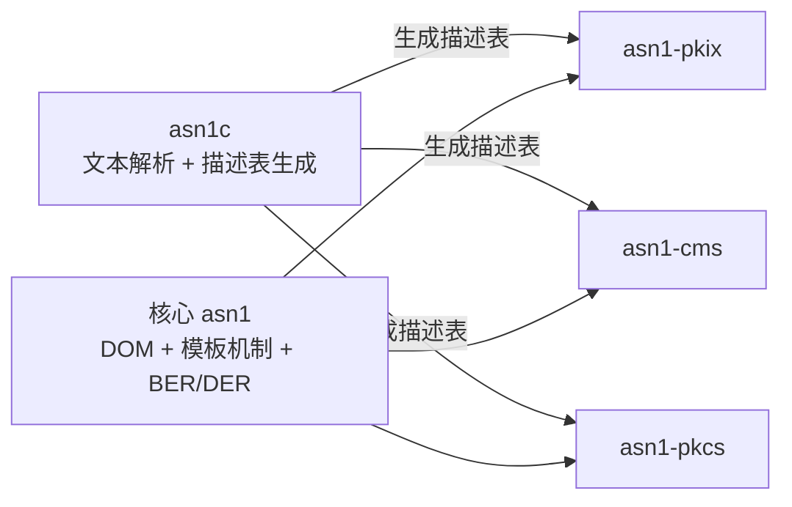

# 里程碑与分期

本文件定义从文档基线到可用版本的阶段划分、依赖关系与验收标准。只使用单一分期设定，不引入编号式多版本。

## 1. 当前状态

| 阶段 | 内容 | 状态 |
| --- | --- | --- |
| M0 | 文档基线、ADR、目录与构建骨架 | 已完成 |
| M1 | 核心骨架与多包构建可配置、可构建 | 已完成 |
| 一期 | 核心 DOM、模板机制、`asn1c` MVP、`asn1-pkix` | 已完成 |
| 二期第一批 | `asn1-pkcs` 只读结构访问（PKCS#1 + PKCS#8 与 PKCS#10 已落地，PKCS#12 后置） | 进行中 |
| 二期第二批 | `asn1-cms` 只读结构访问 + `ContentInfo`/`SignedData` 结构构造（写；其余 CMS 结构后置） | 进行中（只读与结构构造切片已落地） |

一期当前拆解：

- 已完成：上下文/内存模型（含静态池与兜底回收边界）、错误模型与上下文级错误详情、DOM 值树（文档/节点创建与封存、只读访问）、值读取（BOOLEAN、INTEGER、ENUMERATED、OCTET STRING、BIT STRING、OID、UTF-8 字符串、大整数、时间）、schema 模板骨架（运行时注册与描述表加载共用类型树、结构/约束合法性校验、封存检查）、BER `consumed` 与多字节 tag number、BER 不定长（单层/嵌套/EOC、`tlv_size` 含 EOC、构造内容合并）、DER 严格解码校验、DER 编码器（缓冲与 writer 两种输出、`max_output_bytes` 预算）、ANY 的 schema 注册/描述表 `kind = 6`/无包装与 `EXPLICIT` 包装节点语义/编码回写、`SEQUENCE` 中 DEFAULT ANY 末位与 `SET` 禁止规则、`SET OF ANY`、schema 感知解码（buffer/reader 两条路径）、约束求值（RANGE/SIZE/ENUM/MAX/BIGINT）、`asn1_doc_validate`、schema 感知编码（DEFAULT 省略、字段顺序、SET/SET OF 排序、EXPLICIT ANY 重包装、SEQUENCE 未知字段保留、SET 未知字段拒绝、ANY/保留 TLV 的 DER 一致性校验）与 `ASN1_CAP_ANY_OPEN_TYPE` 置位、`asn1_decode_reader`（分段拉取、`consumed`、IO 回调包装）、`asn1c` MVP（词法/语法解析、语义校验、描述表 1.0 生成、C 数组与二进制两种产物、CRC32C、确定性可复现、CLI 与诊断格式）、描述表名称表（BIT 命名位 / 数值名，`header_size = 108`）、`asn1-pkix` 模块（检入描述表、证书打开/关闭、路径查找、常用字段访问器、独立 `find_package` 消费）。
- 进行中：无。
- 二期任务：多模块 `IMPORTS`、参数化类型展开；模糊测试与差分测试已落地，见[测试与验证](07-测试与验证.md)。
- 分期说明：一期 `asn1c` 输入为自包含展平模块，`IMPORTS` 与参数化仅报明确诊断（9007/9006）；直读原始 RFC 模块与跨模块引用留二期，不能把 `asn1c` 整体标为完成。

一期后续子阶段（DER 严格模式，已落地）：最短长度编码、BOOLEAN 仅接受 `0x00`/`0xFF`、INTEGER/ENUMERATED 无冗余前导字节、构造字符串禁止、SET/SET OF 排序、时间规范化（必填秒、DER 只接受 `Z`、无冗余小数尾零）、OID 最短 base128；违反返回 `ASN1_E_NON_CANONICAL`，不定长与 EOC 返回 `ASN1_E_INDEFINITE_NOT_ALLOWED`。`ASN1_ENCODING_DER` 现已按上述规则严格解码。

编码阶段子项：DER 输出规范化与 SET/SET OF 排序已落地；schema 感知编码已落地，按 schema 省略 DEFAULT、按字段顺序输出、重排 SET/SET OF 并重新包装 EXPLICIT ANY；描述表默认值仍只做结构级规范校验，见[描述表格式](11-描述表格式.md)第 7 节。

## 2. 依赖关系

- 核心不依赖任何模块或工具。
- 模块只依赖核心；模块之间不互相依赖。`asn1-cms` 需要的 PKIX 类型在 CMS 自己的展平模块中复制，不新增 `asn1-cms → asn1-pkix` 依赖（见 [ADR-0012](adr/0012-标准模块路线与只读边界.md)）。
- 工具在构建期生成描述表，不作为模块的运行时依赖。

## 3. 一期范围

### 3.1 硬前置任务：产出 PKIX 展平模块

| 项 | 内容 |
| --- | --- |
| 任务定位 | `asn1c` 端到端验收与 `asn1-pkix` 描述表生成的**硬前置**；未完成时一期验收不能通过 |
| 输入来源 | RFC 5912 的 `PKIX1Explicit-2009`、`PKIX1Implicit-2009`、`PKIX-CommonTypes-2009`；原版文本放入 `modules/pkix/asn1/reference/rfc5912/`，只作参考 |
| 产出形态 | `modules/pkix/asn1/` 下的展平 `.asn1` 纯文本；允许合并为自包含单文件（当前为 `PKIX-Flattened-2009.asn1`），不得包含 `CLASS`、`WITH SYNTAX` 或信息对象集；不做任何标签/约束/顺序改动 |
| 验收方式 | 与 RFC 5912 原版**类型集合一一对账**：类型名、字段顺序、`OPTIONAL`/`DEFAULT`/扩展位置、有效标签、约束、抽样 DER 编码等价、可复现，规则见[描述表格式](11-描述表格式.md)第 14.2 节 |
| 当前状态 | 已产出 `modules/pkix/asn1/PKIX-Flattened-2009.asn1`；类型集合对账表见同目录 `reconciliation.md`，8 条 Verified 勘误不改变保留类型 |

该任务必须显式排入一期执行序列，不得以注释或“后续再说”的方式隐藏；其完成时间直接决定 `asn1c` 能否开始端到端验收，也决定 `asn1-pkix` 能否生成描述表。

### 3.2 交付内容

- 核心 C ABI：文档、节点、编解码、错误、内存、告警、模板注册/加载。
- BER 解码（含不定长）与 DER 解码/编码；解码选项、`consumed`、告警载体。
- 通用 DOM 与 runtime 构树。
- 模板机制：已编译描述表加载 + 运行时注册，构建同一类型树；类型种类/标注方式、字段命名、结构/约束校验、`CHOICE` 分支、`SEQUENCE OF`/`SET OF`、`OPTIONAL`、`DEFAULT`（规范 DER TLV）与扩展标记判定。
- 描述表格式冻结：`uint8_t[]` 显式小端读取、版本兼容、越界校验与展平等价性检查，见[描述表格式](11-描述表格式.md)。
- 核心值类型能力：大整数只读视图与严格十进制导出、BIT STRING 位级读取、字符串白名单 UTF-8 转换、UTCTime/GeneralizedTime 结构化只读解析（含纳秒与时区偏移）、OID 点分文本。
- `asn1c` MVP：解析自包含展平模块的 `.asn1` 文本、基础语义校验、生成 C 数组或二进制描述表（含名称表）；诊断格式与错误码冻结；`IMPORTS` 与参数化仅报明确诊断（9007/9006），解析留二期。
- `CLASS`/`WITH SYNTAX`/信息对象集：一期以预展开模块作为输入，原版模块保留作参考，CI 校验类型集合逐一对应。
- `asn1-pkix`：RFC 5912 描述表 + 证书字段访问 C API，作为模板机制首个消费者。
- 测试、示例、CI 与内存检查基线。

### 3.3 验收标准

1. **通用编解码**：BER 不定长、DER 严格模式、DER 输出规范化、SET/SET OF 排序通过规范用例与差分测试。
2. **模板等价性**：同一份 PKIX 描述，分别用描述表加载与运行时注册构建类型树，字段名、约束结果、解码结构完全一致。
3. **描述表生成**：`asn1c` 能从 RFC 5912 展平模块生成描述表；生成过程可复现，C 数组与二进制逐字节同布局；CI 校验生成产物与工具输出一致，并校验展平模块与原版类型集合逐一对应。
4. **证书解析**：`asn1-pkix` 能解析真实 X.509 证书，取到 subject、issuer、validity、extensions；未知扩展保留原始 TLV。（已验收：RSA 自签、RSA-PSS、EC 自签三张证书；`algorithmIdentifier.parameters` 的 NULL/内层 SEQUENCE/缺省三种形态均以原始 TLV 返回，`child_count = 0`。）
5. **约束校验**：PKIX 描述表中的字段顺序、必选/可选、`CHOICE`、SIZE/值域/枚举/大整数约束能返回明确错误；扩展标记影响未知字段处理；不实现签名/链/有效期校验。
6. **值类型**：证书中的大整数可导出严格十进制文本；BIT STRING 可读取位长与未使用位数；白名单字符串可转 UTF-8；UTCTime/GeneralizedTime 可结构化读取，纳秒与时区偏移保留。
7. **ABI 与边界**：C99 可包含；C/C++ 示例可运行；核心源码与公共头不出现领域词，CI 静态检查通过。
8. **重建与移植**：共享/静态、仅静态、freestanding 子集、安装与 `find_package(asn1 CONFIG)` 消费通过；`find_package(asn1-pkix CONFIG)` 的共享与静态两种链接独立消费工程均构建并运行通过。
9. **测试**：doctest 单元测试、ASan/UBSan、libFuzzer 种子回归、至少一组外部实现差分测试通过。

### 3.4 模块描述表生成方式

- `asn1-pkix` 的描述表由 `asn1c` 从 RFC 5912 的**展平模块**生成，而不是手写维护；核心不携带任何标准结构表。
- 展平模块与原版模块的关系、来源、勘误与等价性校验见[描述表格式](11-描述表格式.md)第 14、15 节；原版模块只作参考，不参与构建。
- 生成产物已检入 `modules/pkix/generated/`（`pkix_schema.h` 与 `pkix_schema.bin`），保证没有 `asn1c` 的环境也能构建；`-DASN1_PKIX_REGENERATE_TABLE=ON` 时构建期重新生成并逐字节比对，差异即构建失败。
- 模块发布包携带生成后的描述表，宿主无需安装 `asn1c` 即可使用。
- 一期输入是自包含展平模块，不使用 `IMPORTS`；遇到 `IMPORTS` 返回 `ASN1C_E_IMPORT_UNRESOLVED`(9007)。多模块导入与直接消费原始 RFC 模块列为二期任务，见第 4 节。

## 4. 二期范围

| 内容 | 验收标准 |
| --- | --- |
| `asn1-pkcs`（第一批，先做） | 基于自包含展平模块与检入描述表，只读解析 PKCS#1/#8 与 PKCS#10 样例；PKCS#12 后置。不解密、不做 RSA 运算、不验签；`ANY` 只返回原始 TLV |
| `asn1-cms`（第二批，后做） | 基于 RFC 6268 自包含展平模块解析 `ContentInfo`/`SignedData` 样例，并可用 builder 按结构组装、输出 DER；PKIX 类型在 CMS 模块内复制，不依赖 `asn1-pkix`；不验签、不摘要、不解密、不校验证书链；构造侧不生成签名/摘要、不推导版本 |
| 模板增强 | 提供增量/分步校验；错误定位到字段路径；评估直接解析 `CLASS`/`WITH SYNTAX`/信息对象集 |
| `asn1c` 完善 | 完整语义校验、稳定输出格式、可重复构建与版本化描述表；评估多参数参数化 |
| 多模块 `IMPORTS` 与参数化展开（二期） | 支持跨模块类型引用与参数化实例化；在一期诊断（9007/9006）基础上解析并生成等价描述表 |
| 增量 feed | 按 D6 既定方向提供增量输入接口，仍构建 DOM；不替代一期整块/回调入口 |

### 4.1 二期执行顺序与切片

顺序固定为 `asn1-pkcs` 先、`asn1-cms` 后（[ADR-0012](adr/0012-标准模块路线与只读边界.md)）：

| 顺序 | 切片 | 状态 | 边界 |
| --- | --- | --- | --- |
| 1 | PKCS#1（RFC 8017）+ PKCS#8（RFC 5208 及相关勘误），只读 | 已完成 | `PrivateKeyInfo`/`EncryptedPrivateKeyInfo` 结构；`RSAPublicKey`/`RSAPrivateKey` 结构；不解密、不做 RSA 运算与填充 |
| 2 | PKCS#10（RFC 2986），只读 | 已完成 | `CertificationRequest`/`CertificationRequestInfo` 结构；只读结构，不校验证书请求签名 |
| 3 | PKCS#12（RFC 7292），只读 | 未开始 | 后置；不解析受密码保护的内容 |
| 4 | `asn1-cms`（RFC 6268 / RFC 5652），只读 + 结构构造 | 已完成（只读与结构构造切片） | `ContentInfo`/`SignedData` 结构解析与 builder 构造；PKCS#7 归入本模块；PKIX 类型自包含复制；不验签、不摘要、不解密、不校验证书链；构造侧不生成签名/摘要、不推导版本；其余 CMS 结构后置 |

**多模块 `IMPORTS` 与参数化展开的启动条件**（满足任一即列入二期）：

1. 出现无法机械展平的模块（合并后会改变标签、约束或类型集合）。
2. 需要直接消费未经展平的原始 RFC 模块，而不依赖 `modules/` 下的展平产物。
3. 新模块必须跨模块引用，且展平会破坏与原版模块的逐类型对账。

模块各自独立版本；核心 ABI 稳定期内，模块可独立升级而不要求核心同步发版。

## 5. 暂不规划

| 项 | 结论 | 重启条件 |
| --- | --- | --- |
| PER / UPER | 暂不规划 | 出现明确 PER 场景需求（如特定 5G/智能卡项目）；重启前修订 ADR-0002 与 ADR-0009 |
| CER | 需求触发 | 出现明确 CER 使用场景；依赖 DER 基础与规范化规则 |
| SAX / 事件式解析 | 不承诺 | 出现硬性超低内存流式需求时单独评估 |
| 大整数算术、时区归一 | 不做 | 出现明确业务需求时单独评估 |

## 6. 阶段推进规则

- 上一阶段验收未通过，不进入下一阶段；允许并行做不影响验收的实验，但不得把后续能力写进当前承诺。
- 新增标准结构必须先确定独立模块、RFC 模块编号与包名，不得回填核心。
- 新增公共 ABI 必须同步更新 [C API 规范](02-C-API规范.md)、[覆盖度清单](基线覆盖度清单.md) 与 ADR。
- 核心出现领域词、模块反向引用核心内部头文件，均视为阶段验收失败。
